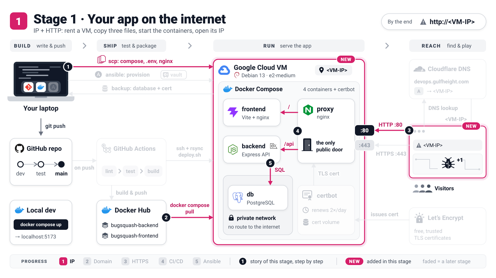

# Stage 1: The app on a bare IP address

[README](../README.md) · **Stage 1** · [Stage 2](stage-2-domain-http.md) · [Stage 3](stage-3-https.md) · [Stage 4](stage-4-automated-deploys.md) · [Stage 5](../ansible/README.md)



Bug Squash Arena already runs on your laptop. Now it moves to a real server: you rent a small
virtual machine (VM) on Google Cloud, install Docker on it, copy three things over from your laptop
and start the same containers there. No domain name and no HTTPS yet: you visit the VM by its IP address.

**By the end:** `http://<VM-IP>` shows the game, and you can sign up and play.

Placeholders: `<VM-IP>` is your VM's external IP address (the instructor's is `34.118.95.243`) and
`<you>` is your user name on the VM. Every command starts with **`laptop$`** (a terminal on your
computer, in the repository folder) or **`vm$`** (a terminal logged in to the VM). Type what comes
after the `$`.

## 1. Create the VM

Why: you need a computer that is always on and reachable from the internet.

In the [Google Cloud console](https://console.cloud.google.com) (a project with billing or the free trial):

1. **Compute Engine -> VM instances -> Create instance**.
2. *Machine configuration*: name **`devops`**, region **`europe-central2` (Warsaw)**, zone
   **`europe-central2-a`**, series **E2**, machine type **`e2-medium`** (2 vCPUs, 4 GB).
3. *OS and storage -> Change*: **Debian GNU/Linux 13 (trixie)**, x86/64, balanced persistent disk, **20 GB**.
4. *Networking*: tick **Allow HTTP traffic** and **Allow HTTPS traffic**. Google's firewall sits
   outside the VM and blocks everything but SSH; these boxes open ports 80 and 443 for this VM.
5. **Create**.

You should see: `devops` in the list with a green check and an **External IP**. That is your `<VM-IP>`.

## 2. Make the IP address static

Why: a normal ("ephemeral") external IP can change when the VM stops, and Stage 2 will point a
domain name at it.

**VPC network -> IP addresses** -> the row with your VM's external address -> **⋮ -> Promote to
static IP address** -> name it **`devops-ip`** -> **Reserve**.

You should see: the same address, now with type **Static**.

## 3. Log in with SSH

Why: the `vm$` commands run in an SSH session, and `scp` in step 6 uses the same key.

```console
laptop$ ssh-keygen -t ed25519 -C <you>       # skip if ~/.ssh/id_ed25519 already exists
laptop$ cat ~/.ssh/id_ed25519.pub
```

In the console: **VM instances -> devops -> Edit -> Security and access -> SSH keys -> Add item**,
paste the whole line, **Save**. The last word of the line becomes your user name on the VM.

```console
laptop$ ssh <you>@<VM-IP>
```

You should see: a one-time *"Are you sure you want to continue connecting?"* (answer `yes`), then
the prompt `<you>@devops:~$`.

## 4. Install Docker

Why: Docker is the only software the VM needs. Even the web server (nginx) runs as a container.
These are the official commands from [docs.docker.com](https://docs.docker.com/engine/install/debian/):

```console
vm$ sudo apt-get update
vm$ sudo apt-get install -y ca-certificates curl
vm$ sudo install -m 0755 -d /etc/apt/keyrings
vm$ sudo curl -fsSL https://download.docker.com/linux/debian/gpg -o /etc/apt/keyrings/docker.asc
vm$ sudo chmod a+r /etc/apt/keyrings/docker.asc
vm$ sudo tee /etc/apt/sources.list.d/docker.sources <<EOF
Types: deb
URIs: https://download.docker.com/linux/debian
Suites: $(. /etc/os-release && echo "$VERSION_CODENAME")
Components: stable
Signed-By: /etc/apt/keyrings/docker.asc
EOF
vm$ sudo apt-get update
vm$ sudo apt-get install -y docker-ce docker-ce-cli containerd.io docker-buildx-plugin docker-compose-plugin
vm$ sudo usermod -aG docker "$USER"          # use docker without sudo...
vm$ exit                                     # ...after logging in again
laptop$ ssh <you>@<VM-IP>
vm$ docker run --rm hello-world
vm$ docker compose version
```

You should see: `Hello from Docker!` and `Docker Compose version v5.6.0` (or newer).
Membership in the `docker` group is as powerful as root, so only add accounts you trust.

## 5. Create `.env.prod` on your laptop

Why: passwords and settings must never be in Git, so they live in one private file that you keep on
your laptop and copy to the VM.

```console
laptop$ cp .env.prod.example .env.prod
laptop$ chmod 600 .env.prod
laptop$ openssl rand -hex 32                 # run it twice: one value per secret
```

Open `.env.prod` in any editor and make these lines look like this (leave the rest as it is):

```dotenv
DOCKER_HUB_USERNAME=alhuraibisaeed
IMAGE_TAG=latest
DOMAIN=
POSTGRES_PASSWORD=<first openssl value>
JWT_SECRET=<second openssl value>
COOKIE_SECURE=false
```

You should see: `laptop$ grep -E '^(DOCKER_HUB_USERNAME|DOMAIN|COOKIE_SECURE)=' .env.prod` prints
exactly `DOCKER_HUB_USERNAME=alhuraibisaeed`, `DOMAIN=` and `COOKIE_SECURE=false`.

> **Concept: environment file.** `.env.prod` is the app's private settings sheet. The images are the
> same for everyone; Compose reads this sheet and hands each value to the container that needs it.
> It is git-ignored, so your secrets never reach GitHub.

> [!WARNING]
> Keep `COOKIE_SECURE=false` while the site is plain `http://`. A cookie marked *Secure* may only
> travel over HTTPS, so the browser silently drops the login cookie and you bounce back to the login
> page. You switch it to `true` in Stage 3.

## 6. Copy the bundle to the VM

Why: the VM never gets the source code, only the run instructions (Compose file), the settings and
the proxy's config. The images come ready-made from Docker Hub.

```console
vm$ sudo mkdir -p /opt/devops-workshop/deploy
vm$ sudo chown -R "$USER": /opt/devops-workshop
laptop$ scp docker-compose.prod.yml .env.prod <you>@<VM-IP>:/opt/devops-workshop/
laptop$ scp -r deploy/nginx <you>@<VM-IP>:/opt/devops-workshop/deploy/
vm$ chmod 600 /opt/devops-workshop/.env.prod
vm$ cd /opt/devops-workshop && find . -type f | sort
```

You should see:

```text
./.env.prod
./deploy/nginx/select-site-config.sh
./deploy/nginx/snippets/acme-challenge.conf
./deploy/nginx/snippets/cloudflare-real-ip.conf
./deploy/nginx/snippets/healthz.conf
./deploy/nginx/snippets/http-level.conf
./deploy/nginx/snippets/proxy-to-app.conf
./deploy/nginx/snippets/security-headers.conf
./deploy/nginx/templates/http-only/site.conf.template
./deploy/nginx/templates/https/site.conf.template
./docker-compose.prod.yml
```

## 7. Start the stack

Why: one command downloads the images and starts the four containers in the right order.

```console
vm$ cd /opt/devops-workshop
vm$ docker compose -f docker-compose.prod.yml --env-file .env.prod up -d
vm$ docker compose -f docker-compose.prod.yml --env-file .env.prod ps
```

You should see, after about a minute of downloads, `Container bugsquash-proxy-1 Started`, then:

```text
NAME                   IMAGE                                      ...  STATUS                    PORTS
bugsquash-backend-1    alhuraibisaeed/bugsquash-backend:latest    ...  Up 33 seconds (healthy)   3000/tcp
bugsquash-db-1         postgres:17.11-alpine3.24                         ...  Up 39 seconds (healthy)   5432/tcp
bugsquash-frontend-1   alhuraibisaeed/bugsquash-frontend:latest   ...  Up 27 seconds (healthy)   8080/tcp
bugsquash-proxy-1      nginx:1.30.5-alpine3.24                          ...  Up 27 seconds (healthy)   0.0.0.0:80->80/tcp, [::]:80->80/tcp, 0.0.0.0:443->443/tcp, [::]:443->443/tcp
```

All four are `healthy`, and only the proxy has `0.0.0.0:...` ports: it is the only way in.

> **Concept: reverse proxy.** The proxy is a receptionist who greets every visitor and sends them to
> the right office: `/api/...` to the backend, everything else to the frontend. The other containers
> never face the internet, and in Stage 3 the receptionist also handles HTTPS for all of them.

## 8. Open the site

Why: prove it works from the outside, exactly like a visitor.

```console
laptop$ curl http://<VM-IP>/api/health
```

You should see: `{"status":"ok","version":"afbdec7"}`, where `version` is the commit that CI built.
`ok` also means the backend could talk to the database, yet the database itself stays private: the
answer is kept this short on purpose, because anyone on the internet can call it. Now open **`http://<VM-IP>`** in your browser: sign up, squash some bugs and
check the leaderboard. The page footer shows the same version.

## 9. Explore

Why: these are the commands you will use every day to see what the server is doing.

```console
vm$ docker compose -f docker-compose.prod.yml --env-file .env.prod logs proxy | grep select-site-config
vm$ docker compose -f docker-compose.prod.yml --env-file .env.prod logs -f backend    # Ctrl+C to stop
vm$ docker compose -f docker-compose.prod.yml --env-file .env.prod stats --no-stream
vm$ docker volume ls
```

You should see: `select-site-config: DOMAIN is empty - using the HTTP-only site config (any host
name, e.g. http://<server IP>/)`; your own requests in the backend log while you play; a stats
table whose `MEM USAGE / LIMIT` column ends in `256MiB`, `64MiB` and `512MiB`; and three volumes:
`bugsquash_certbot-webroot`, `bugsquash_letsencrypt`, `bugsquash_pgdata`.

> **Concept: Docker volume.** Players and scores live in the volume `bugsquash_pgdata`, not inside
> the db container. A volume is a USB stick that survives when you replace the container: plug it
> into the new one and the data is there. Only `docker compose down -v` deletes it, so never run that
> on the VM.

## Checkpoint

- The VM runs four containers, and only the proxy listens on the internet (ports 80 and 443).
- `http://<VM-IP>` serves the game; sign-up and login work over plain HTTP (`COOKIE_SECURE=false`).
- Scores live in the `bugsquash_pgdata` volume; the master copy of `.env.prod` lives on your laptop.

Next: nobody remembers an IP address. [Stage 2](stage-2-domain-http.md) gives the site a name.

<details>
<summary>Going deeper: the same VM with the gcloud CLI</summary>

Steps 1 to 3 as commands (install the CLI from <https://cloud.google.com/sdk/docs/install> or use
Cloud Shell):

```console
laptop$ gcloud compute instances create devops --zone=europe-central2-a --machine-type=e2-medium \
          --image-family=debian-13 --image-project=debian-cloud \
          --boot-disk-size=20GB --boot-disk-type=pd-balanced --tags=http-server,https-server
laptop$ gcloud compute firewall-rules create default-allow-http  --allow=tcp:80  --target-tags=http-server
laptop$ gcloud compute firewall-rules create default-allow-https --allow=tcp:443 --target-tags=https-server
laptop$ gcloud compute addresses create devops-ip --region=europe-central2 --addresses=<VM-IP>
laptop$ gcloud compute ssh devops --zone=europe-central2-a
```

The console's two checkboxes do the same as `--tags` plus the two firewall rules (if the rules
already exist, "already exists" is fine). `gcloud compute ssh` creates its own key
(`~/.ssh/google_compute_engine`), and `gcloud compute scp` copies files with it. Machine types,
firewall details and costs: [Google Cloud reference](gcp-vm-setup.md).

</details>

<details>
<summary>Going deeper: why only the proxy publishes ports</summary>

Docker publishes a port with its own NAT rules, which forward packets to the container *before* a
host firewall such as `ufw` ever sees them. A published `3000:3000` would therefore be open to the
whole internet whatever `ufw` says, with only Google's firewall in the way. That is why the backend,
frontend and database publish nothing: they talk on private Docker networks, and the proxy is the
single entrance. Check it: `laptop$ curl -m 5 http://<VM-IP>:3000/api/health` times out.
[Chapter 7 of the theory notes](../docs/containers-deep-dive.md#72-networks--network-namespaces--bridges)
explains the kernel side.

</details>

## Troubleshooting

| Symptom | Fix |
|---------|-----|
| `ssh: Permission denied (publickey)` | The key was not saved on the VM, or your user name differs from the last word of the key line. Repeat step 3. If your project enforces OS Login, use `gcloud compute ssh` (see *Going deeper*). |
| `permission denied while trying to connect to the Docker daemon socket` | You did not log in again after `usermod -aG docker`: `exit`, then `ssh` again. |
| `bind source path does not exist: /opt/devops-workshop/deploy/nginx` | The proxy config is missing. Run the `scp -r deploy/nginx ...` line of step 6 again. |
| `POSTGRES_PASSWORD is required` (or `JWT_SECRET`, `DOCKER_HUB_USERNAME`) | A value in `.env.prod` is empty, or you forgot `--env-file .env.prod`. Fix it on the laptop and copy it again. |
| The browser times out on `http://<VM-IP>`, but `vm$ curl http://localhost` works | The firewall does not let port 80 in: **VM -> Edit ->** tick **Allow HTTP traffic** and **Allow HTTPS traffic** -> **Save**. |
