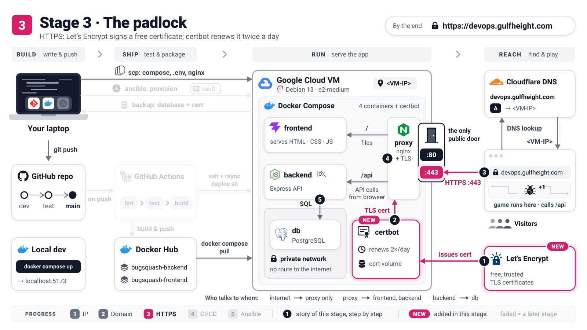

# Stage 3: HTTPS with Let's Encrypt

[README](../README.md) · [Stage 1](stage-1-ip-http.md) · [Stage 2](stage-2-domain-http.md) · **Stage 3** · [Stage 4](stage-4-automated-deploys.md) · [Stage 5](../ansible/README.md)



The site has a name, but everything still travels as readable text and the browser says *Not
secure*. Now you ask Let's Encrypt for a free certificate, proving that you control
`devops.gulfheight.com`, and the proxy switches itself to HTTPS. Nothing new is installed on the VM:
certbot, the Let's Encrypt client, runs as a one-off container.

**By the end:** `https://devops.gulfheight.com` shows a padlock, every `http://` address redirects
there, and the certificate renews itself.

Same conventions as in [Stage 1](stage-1-ip-http.md): `laptop$` or `vm$` shows where a command runs.
Before you start, `dig +short devops.gulfheight.com @1.1.1.1` must print your VM's IP
([Stage 2](stage-2-domain-http.md)).

> **Concept: TLS certificate.** A certificate is an ID card that says "I am devops.gulfheight.com",
> signed by a trusted notary (Let's Encrypt) whose signature every browser can check. Before signing,
> the notary checks that you control the name: it fetches a random token from
> `http://devops.gulfheight.com/.well-known/acme-challenge/` (the *HTTP-01 challenge*).

## 1. Copy the whole `deploy/` folder

Why: from now on the VM also needs the renewal timer (`deploy/systemd/`) and the helper scripts.

```console
laptop$ scp -r deploy <you>@<VM-IP>:/opt/devops-workshop/
vm$ ls /opt/devops-workshop/deploy /opt/devops-workshop/deploy/systemd
```

You should see `deploy.sh`, `nginx`, `systemd` and `tls.sh` (plus these guides), and in `systemd/`
the two files `bugsquash-tls-renew.service` and `bugsquash-tls-renew.timer`.

## 2. Rehearse with a staging certificate

Why: Let's Encrypt limits mistakes (for example 5 failed validations per name per hour); its
*staging* server has generous limits and issues test certificates that browsers do not trust,
which makes it perfect for a rehearsal.

```console
vm$ cd /opt/devops-workshop
vm$ docker compose -f docker-compose.prod.yml --env-file .env.prod run --rm certbot \
      certonly --webroot -w /var/www/certbot -d devops.gulfheight.com \
      --email <your-email> --agree-tos --no-eff-email --staging
```

`run --rm certbot` starts a one-off certbot container and deletes it afterwards. `certonly --webroot
-w /var/www/certbot` means: only fetch the certificate, and put the token in the shared folder that
the proxy serves. Use an e-mail address you read (Let's Encrypt rejects `example.com`), or replace
`--email <your-email>` with `--register-unsafely-without-email`.

You should see:

```text
Account registered.
Requesting a certificate for devops.gulfheight.com

Successfully received certificate.
Certificate is saved at: /etc/letsencrypt/live/devops.gulfheight.com/fullchain.pem
Key is saved at:         /etc/letsencrypt/live/devops.gulfheight.com/privkey.pem
This certificate expires on 2027-01-11.
```

## 3. Switch the proxy to HTTPS

Why: the proxy chooses its config when it starts; after a restart it finds the certificate and
turns HTTPS on by itself.

```console
vm$ docker compose -f docker-compose.prod.yml --env-file .env.prod restart proxy
vm$ docker compose -f docker-compose.prod.yml --env-file .env.prod logs proxy | grep select-site-config
laptop$ curl -I http://devops.gulfheight.com/
laptop$ curl https://devops.gulfheight.com/
```

You should see the new log line, the redirect, and an error that is **correct** for a staging
certificate (signed by a test notary nobody trusts):

```text
proxy-1  | select-site-config: certificate found for devops.gulfheight.com - using the HTTPS site config
HTTP/1.1 301 Moved Permanently
Location: https://devops.gulfheight.com/
curl: (60) SSL certificate problem: unable to get local issuer certificate
```

The whole flow works. Time for the real certificate.

## 4. Get the real certificate

Why: same command without `--staging`. A certificate with this name already exists (the staging
one), so `--force-renewal` replaces it instead of stopping to ask *Keep / Renew & replace*.

```console
vm$ docker compose -f docker-compose.prod.yml --env-file .env.prod run --rm certbot \
      certonly --webroot -w /var/www/certbot -d devops.gulfheight.com \
      --email <your-email> --agree-tos --no-eff-email --force-renewal
vm$ docker compose -f docker-compose.prod.yml --env-file .env.prod restart proxy
laptop$ curl -sI https://devops.gulfheight.com/ | grep -iE '^(HTTP|strict-transport)'
laptop$ echo | openssl s_client -connect devops.gulfheight.com:443 -servername devops.gulfheight.com 2>/dev/null | openssl x509 -noout -issuer -dates
```

You should see `Renewing an existing certificate for devops.gulfheight.com` and `Successfully
received certificate.`, then, with no `-k` needed because the certificate is trusted:

```text
HTTP/2 200
strict-transport-security: max-age=31536000; includeSubDomains
issuer=C = US, O = Let's Encrypt, CN = YE1
notBefore=Oct 13 13:28:41 2026 GMT
notAfter=Jan 11 13:28:40 2027 GMT
```

`HTTP/2` is the faster protocol that comes with HTTPS. `strict-transport-security` (HSTS) tells
browsers to use only HTTPS for this name for the next year. The issuer name (`YE1`) may differ for
you. Open **`https://devops.gulfheight.com`**: padlock.

## 5. Secure the login cookie

Why: now that every page is HTTPS, the login cookie may be marked *Secure*, so it can never leak
over plain HTTP.

Edit `.env.prod` on your laptop: `COOKIE_SECURE=true`. Then copy and apply it:

```console
laptop$ scp .env.prod <you>@<VM-IP>:/opt/devops-workshop/
vm$ docker compose -f docker-compose.prod.yml --env-file .env.prod up -d
```

You should see `Container bugsquash-backend-1 Recreate`: only the backend reads this setting. Log in
on the site; in the browser's DevTools (*Application -> Cookies*) `bugsquash_token` now has
*Secure* ticked.

## 6. Renew automatically

Why: certificates live 90 days, and certbot renews one about 30 days before it expires, but only if
something runs certbot regularly.

First prove that a renewal would succeed (a dry run talks to staging and saves nothing):

```console
vm$ docker compose -f docker-compose.prod.yml --env-file .env.prod run --rm certbot renew --dry-run
```

You should see `Congratulations, all simulated renewals succeeded`. A real renewal is two commands:
`... run --rm certbot renew` (renews only when due) and `... exec proxy nginx -s reload` (nginx
loads the new files without dropping a single connection). [`deploy/tls.sh`](tls.sh) `renew` runs
exactly these two, plus a lock and some checks, and a systemd timer runs that twice a day:

```console
vm$ sudo cp /opt/devops-workshop/deploy/systemd/bugsquash-tls-renew.service \
            /opt/devops-workshop/deploy/systemd/bugsquash-tls-renew.timer /etc/systemd/system/
vm$ sudo systemctl daemon-reload
vm$ sudo systemctl enable --now bugsquash-tls-renew.timer
vm$ systemctl list-timers bugsquash-tls-renew.timer
vm$ sudo systemctl start bugsquash-tls-renew.service
vm$ sudo journalctl -u bugsquash-tls-renew.service -n 10 -o cat
```

You should see the next run within 12 hours, and the test run's report:

```text
NEXT                        LEFT LAST PASSED UNIT                      ACTIVATES
Wed 2026-10-14 00:21:45 UTC   9h -         - bugsquash-tls-renew.timer bugsquash-tls-renew.service

==> Renew the certificate for devops.gulfheight.com (if due)
  [ok] Certificate not due for renewal - nothing changed
  [ok] Proxy reloaded
```

> **Concept: systemd timer.** A timer is the VM's alarm clock: at 00:00 and 12:00 (plus a random
> delay of up to an hour) it starts the service, which runs `tls.sh renew` once and exits. If the VM
> was off at that moment, it catches up right after the next boot.

## Checkpoint

- `https://devops.gulfheight.com` has a trusted Let's Encrypt certificate, HTTP/2 and HSTS.
- `http://devops.gulfheight.com` and `http://<VM-IP>` redirect to HTTPS.
- The login cookie is *Secure*, and a timer renews the certificate twice a day.

Next: every change still means copying files and typing commands by hand.
[Stage 4](stage-4-automated-deploys.md) lets GitHub Actions deploy for you.

<details>
<summary>Going deeper: the tls.sh shortcut, cron and rate limits</summary>

- **Shortcut.** `./deploy/tls.sh issue --staging` and then `./deploy/tls.sh issue` do steps 2 to 4 in
  one command each: check that DNS points at this VM, run certbot, restart the proxy and test the
  result. `./deploy/tls.sh status` lists the certificates. It takes the e-mail address from
  `LETSENCRYPT_EMAIL` in `.env.prod` (empty = no address).
- **Cron instead of the timer.** One line in root's crontab (`sudo crontab -e`) does the same job:
  `17 3,15 * * * /bin/bash /opt/devops-workshop/deploy/tls.sh renew >/dev/null 2>&1`.
  The timer wins on visibility: `systemctl list-timers` and `journalctl` show what happened.
- **Why the timer runs as root.** It must read `.env.prod` (mode `0600`) whoever owns the folder:
  you now, the `deploy` user from Stage 4. Membership in the `docker` group is root-equivalent
  anyway, so root adds no real power here.
- **Rate limits.** At most 5 certificates for the same name per week and 5 failed validations per
  name per hour (<https://letsencrypt.org/docs/rate-limits/>). `--staging` and `--dry-run` do not count.
- **HSTS is sticky.** A browser that has seen the header refuses plain `http://devops.gulfheight.com`
  for a year, even on a rebuilt VM that is back at Stage 2. Use a private window, or clear the name
  at `chrome://net-internals/#hsts`.

</details>

<details>
<summary>Going deeper: Cloudflare's orange cloud (optional)</summary>

With the orange cloud (*Proxied*), browsers connect to Cloudflare, which hides your IP, filters
attacks and caches files, then opens a **second** HTTPS connection to your proxy. Rules:

- **SSL/TLS -> Overview -> Full (strict)**: Cloudflare checks your Let's Encrypt certificate on that
  second connection. **Never "Flexible"**: Cloudflare would talk plain HTTP to port 80, the proxy
  answers "go to HTTPS", Cloudflare asks over HTTP again... `ERR_TOO_MANY_REDIRECTS`.
- Uncomment [`deploy/nginx/snippets/cloudflare-real-ip.conf`](nginx/snippets/cloudflare-real-ip.conf),
  copy `deploy/nginx` again and run `vm$ docker compose -f docker-compose.prod.yml --env-file .env.prod
  exec proxy nginx -s reload`, so logs and the login rate limit see real visitor IPs instead of Cloudflare's.
- Renewals keep working (the challenge folder is served on port 443 too). `tls.sh` needs `FORCE=1`
  for a new certificate, because `dig` now returns Cloudflare's addresses.
- SSH, `scp` and the CI deploy must use the IP address: Cloudflare only proxies web traffic.

</details>

## Troubleshooting

| Symptom | Fix |
|---------|-----|
| certbot: `Timeout during connect (likely firewall problem)` | Let's Encrypt cannot reach port 80. Check the VM's *Allow HTTP traffic* box ([Stage 1](stage-1-ip-http.md#1-create-the-vm)) and that `laptop$ curl -I http://devops.gulfheight.com/.well-known/acme-challenge/x` returns a `404` from nginx. |
| certbot: `DNS problem: NXDOMAIN` or a wrong IP | The name does not point here yet: [Stage 2, step 2](stage-2-domain-http.md#2-check-the-record-from-your-laptop). |
| certbot asks *1: Keep the existing certificate / 2: Renew & replace* | A certificate with this name exists (the staging one). Add `--force-renewal`, or answer `2`. |
| Still plain HTTP after *Successfully received certificate* | The proxy was not restarted: `restart proxy`, then check the `select-site-config` log line. |
| `ERR_TOO_MANY_REDIRECTS` | Cloudflare's orange cloud with SSL mode *Flexible*. Set **Full (strict)**. |
