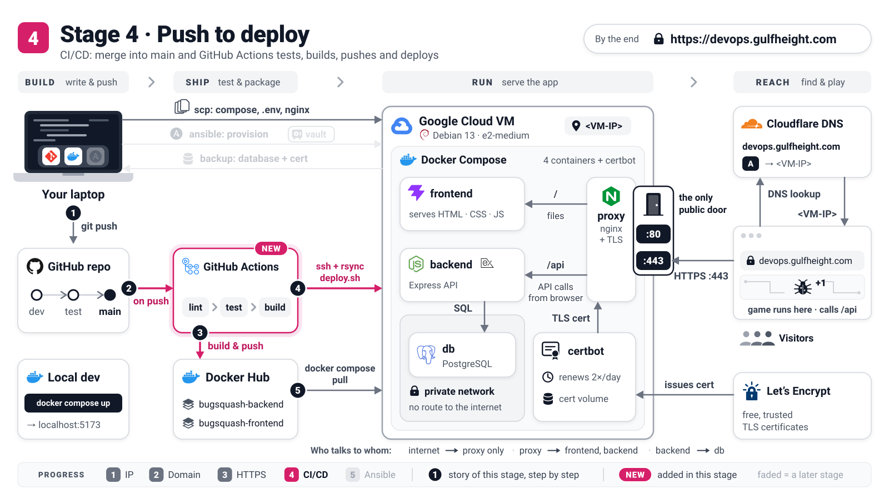

# Stage 4: Automated deploys

[README](../README.md) · [Stage 1](stage-1-ip-http.md) · [Stage 2](stage-2-domain-http.md) · [Stage 3](stage-3-https.md) · **Stage 4** · [Stage 5](../ansible/README.md)



The site is live on HTTPS, but every release still means copying files and typing Compose commands
by hand. In this stage one script does a whole deploy and checks its own work, a dedicated `deploy`
account owns the app on the VM, and GitHub Actions runs the script after every merge into `main`.

**By the end:** merging into `main` puts the new version on `https://devops.gulfheight.com` (the
footer shows its commit), and `./deploy/deploy.sh sha-<commit>` rolls back in one command.

Same conventions as in [Stage 1](stage-1-ip-http.md). You need Stage 3 finished and the Docker Hub
secrets from [README Part 4](../README.md#part-4-github-actions-and-secrets), because CI builds the images.
If your CI pushes to your **own** Docker Hub account, put that name into `DOCKER_HUB_USERNAME` in
`.env.prod` (laptop, then `scp`), or the VM keeps pulling the course images and never finds your builds.

## 1. Deploy with one command

Why: a deploy is a procedure (pull, start, wait, test), and a procedure written in a script runs the
same way every time, for you and for CI.

```console
vm$ cd /opt/devops-workshop
vm$ ./deploy/deploy.sh
```

You should see eight numbered steps (`==> [1/8] Pre-flight checks` ... `==> [8/8] Status`), the
smoke tests among them, and finally:

```text
==> [6/8] Smoke tests (inside each container, then through the proxy)
  [ok] backend  health : backend http://127.0.0.1:3000/api/health -> {"status":"ok","version":"afbdec7"}
  ...
  [ok] http -> https   -> 301 https://devops.gulfheight.com/
  [ok] https api        -> {"status":"ok","version":"afbdec7"}
  [ok] https page       -> HTTP 200, HTTP/2
...
Deploy finished in 9s. Live at https://devops.gulfheight.com (proxy mode: https)
```

The script pulls the images, runs `up -d --wait` (it waits for every healthcheck), reloads the
proxy, tests each container from the inside and the whole path from the outside, and deletes
leftover image layers. If anything fails, it prints the logs and the rollback command.

## 2. Pin a version and roll back

Why: `latest` moves with every build; a `sha-<commit>` tag always means exactly one build, so you can
go back to it.

```console
vm$ ./deploy/deploy.sh sha-0e3ea1a           # an older build (see the Tags tab on Docker Hub)
laptop$ curl https://devops.gulfheight.com/api/health
vm$ ./deploy/deploy.sh                       # back to IMAGE_TAG from .env.prod (latest)
```

You should see `"version":"0e3ea1a"` after the first deploy (the footer agrees), and the newest
version again after the second. Your players and scores are untouched: they live in the volume.

> **Concept: immutable tags.** `latest` is a sticky note that CI moves to every new build; `sha-0e3ea1a`
> is a label printed on one box. Production should run a printed label, so you always know what is
> live and can return to it. Find tags in the CD (main) run summary or on Docker Hub.

## 3. Create the `deploy` user

Why: CI logs in with this account, so it gets exactly what a deploy needs (Docker and the app
folder) and nothing more: no `sudo`.

```console
vm$ sudo useradd --create-home --shell /bin/bash --groups docker deploy
vm$ sudo install -d -m 700 -o deploy -g deploy /home/deploy/.ssh
vm$ sudo cp ~/.ssh/authorized_keys /home/deploy/.ssh/authorized_keys      # your own key, for you
vm$ sudo chown deploy:deploy /home/deploy/.ssh/authorized_keys
vm$ sudo chown -R deploy:deploy /opt/devops-workshop
vm$ sudo apt-get install -y rsync                                          # CI copies files with it
vm$ sudo -l -U deploy
laptop$ ssh deploy@<VM-IP> 'id'
```

You should see `User deploy is not allowed to run sudo on devops.` and `uid=...(deploy) gid=...(deploy)
groups=...(deploy),...(docker)`. From now on copy files as this user, for example
`laptop$ scp .env.prod deploy@<VM-IP>:/opt/devops-workshop/`. The renewal timer from Stage 3 runs as
root, so it keeps working.

> [!WARNING]
> Never add a key for `deploy` through the console's *SSH keys* box or `gcloud compute ssh deploy@...`.
> Google's guest agent would put the account into `google-sudoers`, which means sudo without a password.

## 4. Give CI its own key

Why: a separate key can be revoked on its own, and the `restrict` option lets it run commands but
not open tunnels or terminals.

```console
laptop$ ssh-keygen -t ed25519 -f ~/.ssh/bugsquash_ci -N "" -C "github-actions deploy"
laptop$ cat ~/.ssh/bugsquash_ci.pub
vm$ echo 'restrict ssh-ed25519 AAAA...paste-the-key... github-actions deploy' | sudo tee -a /home/deploy/.ssh/authorized_keys
laptop$ ssh -i ~/.ssh/bugsquash_ci deploy@<VM-IP> 'cd /opt/devops-workshop && ./deploy/tls.sh has-cert'
```

You should see: `certificate for devops.gulfheight.com: production`, printed by the VM over the CI key.

## 5. Pin the VM's identity

Why: CI must refuse to talk to an impostor, so it gets the VM's SSH host key in advance.

```console
laptop$ ssh-keyscan -t ed25519 <VM-IP> 2>/dev/null > bugsquash_known_hosts
laptop$ ssh-keygen -lf bugsquash_known_hosts
vm$ ssh-keygen -lf /etc/ssh/ssh_host_ed25519_key.pub
```

You should see the **same** `SHA256:...` fingerprint twice: the key that answered over the network
is the one stored on the VM.

## 6. Add the GitHub secrets and the switch

Why: the deploy job reads where and how to log in from repository settings, never from the code.

GitHub -> your repository -> **Settings -> Secrets and variables -> Actions**:

| Kind | Name | Value |
|------|------|-------|
| Secret | `DEPLOY_HOST` | `<VM-IP>`, the static IP (not the domain: SSH does not pass Cloudflare's orange cloud) |
| Secret | `DEPLOY_USER` | `deploy` |
| Secret | `DEPLOY_SSH_KEY` | the whole content of `~/.ssh/bugsquash_ci` (the **private** key, BEGIN/END lines included) |
| Secret | `DEPLOY_KNOWN_HOSTS` | the content of `bugsquash_known_hosts` (optional; without it CI trusts the first key it sees and warns) |
| Variable | `ENABLE_AUTO_DEPLOY` | `true` |
| Variable | `DEPLOY_PATH`, `SITE_URL` | optional; defaults `/opt/devops-workshop` and `https://devops.gulfheight.com` |

You should see the four `DEPLOY_*` secrets next to the two Docker Hub ones, and the variable.
Nothing runs yet.

## 7. Ship a change

Why: this is the payoff: a merge is a deploy.

Change something small (a rank title in `app/frontend/src/js/ranks.js`), then promote it
`dev -> test -> main` as in [README Part 3](../README.md#part-3-git-branching-strategy). In the
**Actions** tab, *CD (main)* runs **build** (backend and frontend images) and then **deploy**, which:

1. copies the bundle with `rsync`: `deploy/` (mirrored with `--delete`) and `docker-compose.prod.yml`,
   **never** `.env.prod`, which stays on the VM;
2. runs `ssh deploy@<VM-IP> "cd /opt/devops-workshop && ./deploy/deploy.sh sha-<commit>"`;
3. checks `https://devops.gulfheight.com/api/health` from the internet.

You should see both jobs green, and the footer of `https://devops.gulfheight.com` showing the first
seven characters of your commit (`git log -1 --format=%h main`).

## 8. Roll back a bad release

Why: when a release misbehaves, going back to the last good build is faster than fixing forward.

```console
laptop$ ssh deploy@<VM-IP>
vm$ cd /opt/devops-workshop && ./deploy/deploy.sh sha-<previous-good-commit>
```

You should see the eight steps again and the old version in `/api/health`. The rollback lasts until
the next deploy; to stay on it, set `IMAGE_TAG=sha-...` in `.env.prod` (laptop, copy, deploy). The
real fix is a `git revert` on `dev`, promoted like any change.

> **Concept: least privilege.** The `deploy` account is a key card that opens one door: Docker and
> `/opt/devops-workshop`. If the CI key leaks, an attacker cannot use `sudo`. Note that the `docker`
> group is still powerful, so guard the key like a password.

## Checkpoint

- `./deploy/deploy.sh [sha-...]` deploys, tests itself and prints the rollback command when it fails.
- A no-sudo `deploy` account owns `/opt/devops-workshop`; CI logs in with its own revocable key.
- A merge into `main` reaches production on its own, and the footer proves which commit is live.

Next: the VM itself is still hand-made. [Stage 5 (optional)](../ansible/README.md) rebuilds a deleted
VM, data and certificate included, with one command.

<details>
<summary>Going deeper: approvals and the deploy lock</summary>

- The deploy job runs in the GitHub **environment** `production`. Under *Settings -> Environments ->
  production* you can add **required reviewers**: every release then waits for an approval click.
- `deploy.sh` and `tls.sh` share a lock on `/opt/devops-workshop`, so a CI deploy and a certificate
  renewal never run at the same moment; the second one waits (up to 5 or 10 minutes).
- Why `rsync --delete` only for `deploy/`: a file deleted in Git disappears from the VM too, while
  the bundle root, where `.env.prod` lives, is never mirrored.
- Rehearse a deploy on your laptop without Docker Hub: see the header of [`deploy.sh`](deploy.sh)
  (`SKIP_PULL=1`).

</details>

## Troubleshooting

| Symptom | Fix |
|---------|-----|
| Deploy job: `Permission denied (publickey)` | The CI public key is not in `/home/deploy/.ssh/authorized_keys`, `DEPLOY_USER` is not `deploy`, or `DEPLOY_SSH_KEY` lost its BEGIN/END lines. |
| Deploy job: `Host key verification failed` | The VM was recreated and has a new host key. Repeat step 5 and update `DEPLOY_KNOWN_HOSTS`. |
| Deploy job: `rsync: command not found` | Install it on the VM: `vm$ sudo apt-get install -y rsync`. |
| `scp` or `rsync`: `Permission denied` on `/opt/devops-workshop` | The folder still belongs to your own user: `vm$ sudo chown -R deploy:deploy /opt/devops-workshop`. |
| `deploy.sh`: `Pulling the images failed` ... `Does tag 'sha-...' exist on Docker Hub?` | `DOCKER_HUB_USERNAME` in `.env.prod` is not the account CI pushes to, or the build job has not finished yet. |
| `deploy.sh`: `Containers did not become healthy` | Read the logs it prints, then roll back with the `./deploy/deploy.sh sha-...` command it suggests. |
