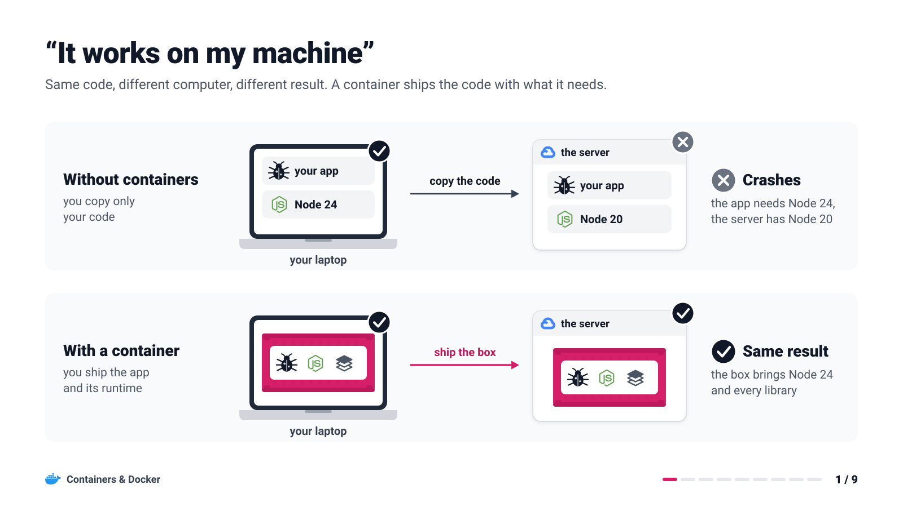
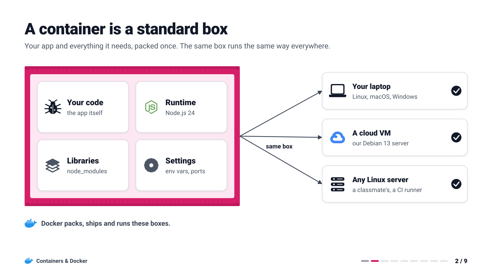
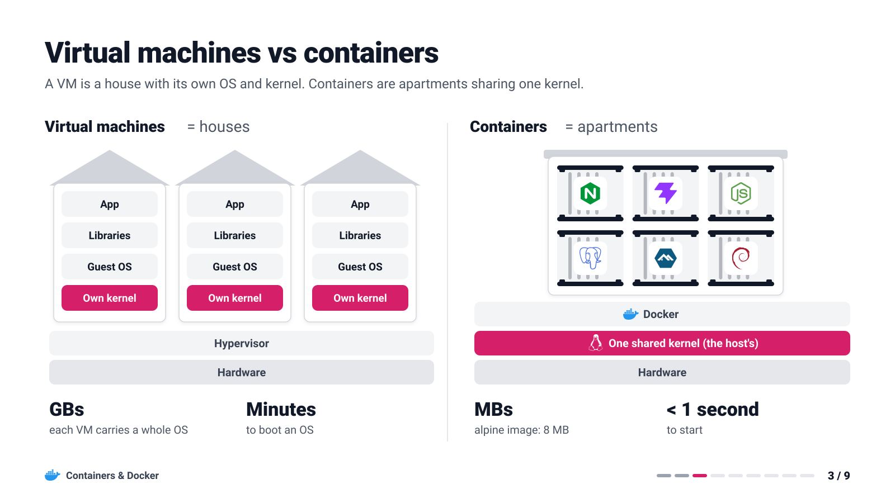
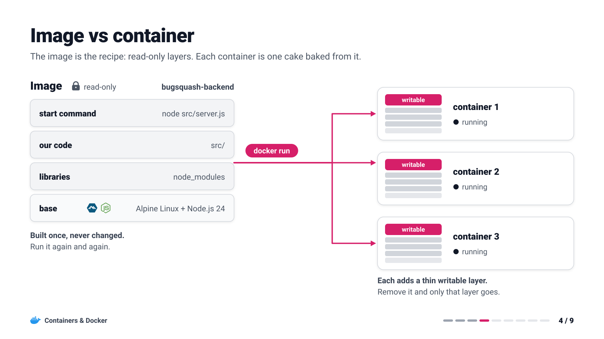
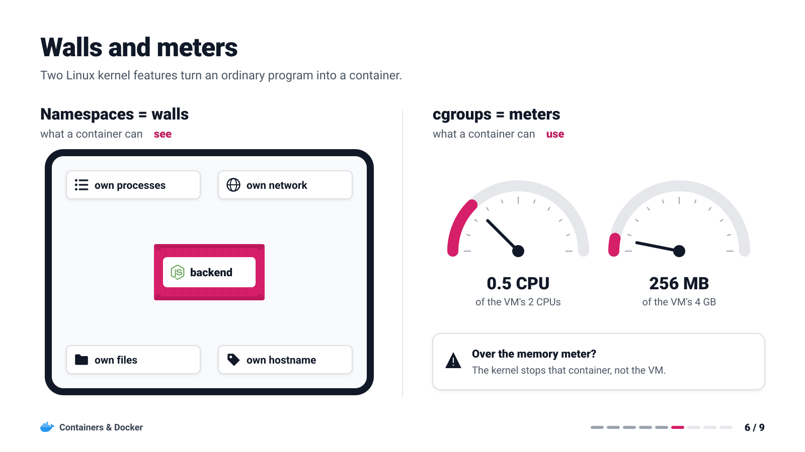
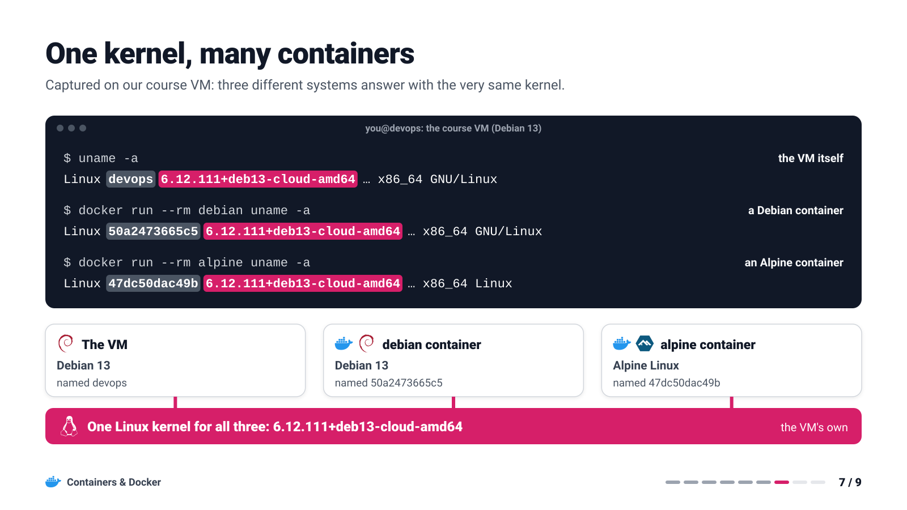
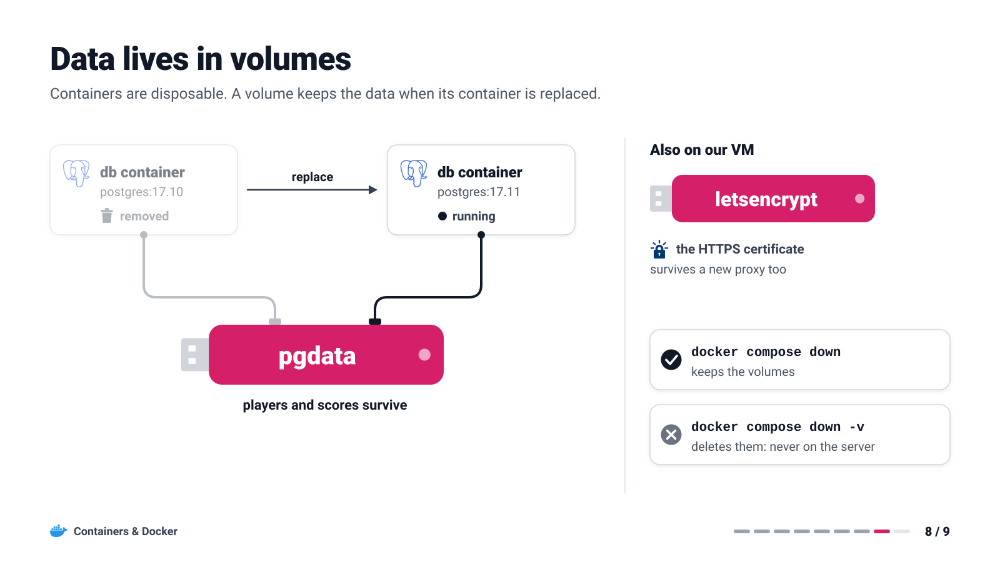

# Containers and Docker

[README](../README.md) · [The deployment journey](../stages/README.md)

Before Bug Squash Arena moves to a server, you need one idea: the container. Nine slides explain it
with pictures and real output from our course VM, and most come with one command to try on your laptop.

## 1. It works on my machine



Your laptop has Node 24; the server has Node 20. Copy only the code and the same app crashes there.
A container ships the app *together with* the runtime and libraries it was tested with.

**Try it:** your laptop's Node version does not matter, or even whether you have Node at all.

```console
laptop$ docker run --rm node:24.21.0-alpine3.24 node --version
```

You should see: `v24.21.0`.

## 2. A container is a standard box



Think of a shipping container. The port crane doesn't care whether it holds bananas or bikes,
because every box has the same shape. Docker does the same for software: code, runtime, libraries
and settings go into one box, and any machine with Docker can run it.

```console
laptop$ docker run --rm hello-world
```

You should see: `Hello from Docker!` and a short explanation of what just happened.

## 3. Virtual machines vs containers



A virtual machine is a house: its own foundation, walls and plumbing, which means a whole operating
system and kernel. Containers are apartments in one building and share its foundation, the host's
kernel. That is why they weigh megabytes and start in under a second. This course uses both:
containers *inside* one Google Cloud VM.

```console
laptop$ time docker run --rm alpine true
```

You should see: run it twice; the second run finishes well under a second (the first one downloads 8 MB).

## 4. Image vs container



An **image** is a recipe: read-only layers, built once. A **container** is one cake baked from it:
the image plus a thin writable layer on top. Start ten containers from one image and you get ten
cakes. Delete one and only its writable layer goes; the image stays.

```console
laptop$ docker pull alhuraibisaeed/bugsquash-backend
laptop$ docker image history alhuraibisaeed/bugsquash-backend
```

You should see: one line per layer, newest first: our start command (`CMD ["node" "src/server.js"]`)
at the top and the Alpine base at the bottom.

## 5. Build, ship, run


Four commands carry our backend from source code to a running container: `build` (Dockerfile to
image), `push` (image to Docker Hub), `pull` (Docker Hub to the VM) and `run` (image to container).
In this course GitHub Actions builds and pushes, and the VM pulls and runs.

```console
laptop$ docker build -t bugsquash-backend app/backend
laptop$ docker image ls bugsquash-backend
```

You should see: the Dockerfile's steps run one by one, then your new image in the list.

## 6. Walls and meters: namespaces and cgroups



A container is an ordinary program with two extras from the Linux kernel. **Namespaces** are the
walls: the program sees only its own processes, network, files and hostname. **cgroups** are the
meters: on our VM the backend may use at most half a CPU and 256 MB of memory.

```console
laptop$ docker run --rm alpine ps
laptop$ docker run --rm --memory 64m alpine cat /sys/fs/cgroup/memory.max
```

You should see: a single process, `ps` itself as PID 1 (the walls), then `67108864`, which is
64 MB in bytes (the meter).

## 7. One kernel, many containers



The proof, captured on our VM (`…` shortens the long lines). Three systems answer: the VM itself,
a Debian container and an Alpine container. Each has its own hostname and its own files, but the
kernel string is identical, because a container has no kernel of its own.

```console
laptop$ uname -r
laptop$ docker run --rm alpine uname -r
```

You should see: the same version twice on Linux. On macOS or Windows they differ, because Docker
Desktop runs containers inside a small hidden Linux VM. On the course VM they always match.

## 8. Data lives in volumes



Containers are disposable: every deploy replaces them. A volume is a USB stick the container plugs
into, and it survives the swap. On our VM `pgdata` holds the players and scores, and `letsencrypt`
holds the HTTPS certificate.

```console
laptop$ docker run --rm -v notes:/data alpine sh -c 'echo hello > /data/note.txt'
laptop$ docker run --rm -v notes:/data alpine cat /data/note.txt
```

You should see: `hello`, written by a container that no longer exists. Clean up with `docker volume rm notes`.

## 9. Many containers, one file: Docker Compose


Our server runs five containers, two networks and two volumes. Typing them out one `docker run` at a
time would be a mess, so `docker-compose.prod.yml` describes them all, and one command starts the
lot. Only the backend sits on both networks, so the database stays unreachable from everything else.

```console
laptop$ docker compose up -d
laptop$ docker compose ps
```

You should see: the local stack (`db`, `backend`, `frontend`) running. The VM runs the bigger
production version from Stage 1 on.

## Cheat sheet

| Command | What it does |
|---|---|
| `docker run --rm -it alpine sh` | start a throwaway container and open a shell in it |
| `docker ps -a` | list containers, including stopped ones |
| `docker images` | list the images on this machine |
| `docker pull <image>` | download an image from a registry |
| `docker build -t <name> <folder>` | build an image from the Dockerfile in a folder |
| `docker logs -f <container>` | follow a container's output |
| `docker exec -it <container> sh` | open a shell inside a running container |
| `docker rm -f <container>` | stop and delete a container |
| `docker compose up -d` | start every service of the Compose file in the background |
| `docker compose ps` | show the stack's containers and their health |
| `docker compose logs -f backend` | follow one service's output |
| `docker compose down` | stop and remove the stack (volumes stay; `-v` would delete them) |

Want the long version (every namespace, cgroup files, overlay layers, the OOM killer)? The original
deep dive is in the Git history: `git show b3f7660:docs/containers-and-docker.md`.

**Next:** [Stage 1: the app on a bare IP address](../stages/stage-1-ip-http.md)
