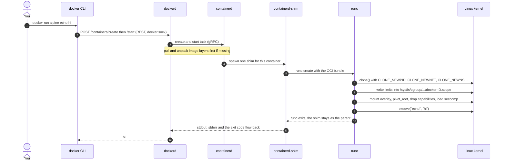
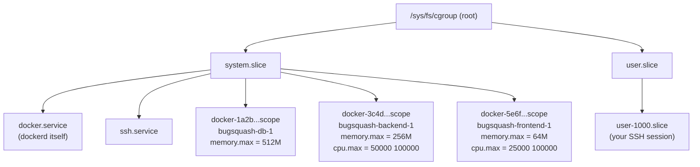
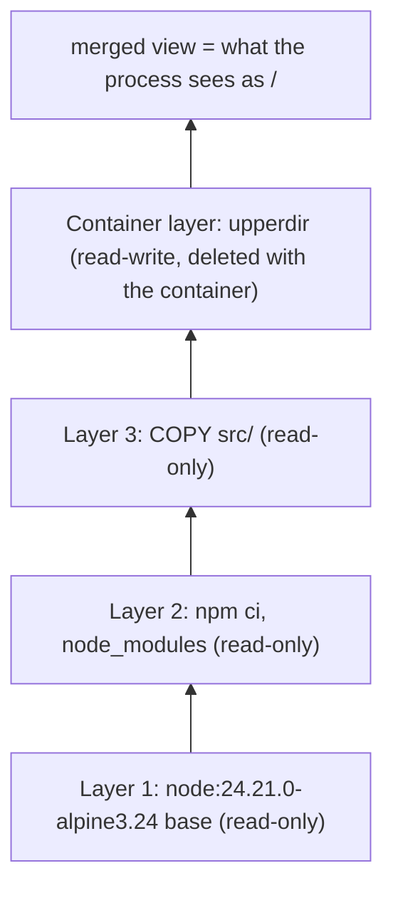
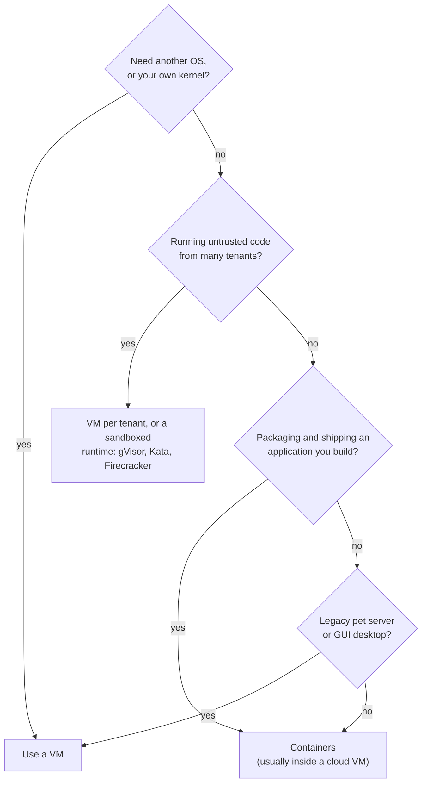
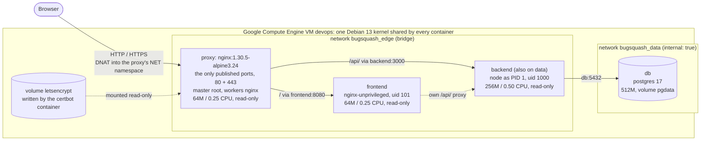

# Containers Deep Dive: What a Container *Really* Is

> **Lecture theory chapter for the Bug Squash Arena DevOps workshop.**
> After this chapter you should be able to explain, and *prove on a terminal*, that a container is
> just a Linux process that the kernel isolates (namespaces), limits (cgroups) and gives its own
> root filesystem (overlay layers), and that Docker is the toolchain that sets all of that up for you.

**How to read this chapter**

- Every command shown here was **run for real** while writing this chapter, on an Ubuntu 24.04 workstation
  (kernel `7.0.0-38-generic`, Docker Engine 29.3, cgroup v2, captured 2026-10-13). Blocks marked
  **Captured** are copy-pasted output. Section 6.2 was captured on our production box, the Google Compute
  Engine VM `devops` (Debian 13 "trixie", Debian's cloud kernel 6.12). Blocks marked **Expected on the GCE
  VM** show what a command prints there; your version numbers, IDs and IP addresses will differ slightly.
- `$` is the shell prompt. Commands that need root are written with `sudo`; keep it on the VM too, where
  you log in as a normal user ([Stage 1](../deploy/stage-1-ip-http.md)). A full prompt such as
  `you@devops:~$` marks a session on the server (Compute Engine sets the hostname to the instance name,
  `devops`). Inside code blocks, lines starting with `#` and the `<-` arrows are explanatory comments
  added for this chapter, not output.
- Commands use `alpine` and `debian` images because they are tiny and they have different userlands,
  which is exactly what makes the experiments convincing.

---

## Table of contents

1. [Containers vs Docker](#1-containers-vs-docker)
2. [Namespaces: what a process can *see*](#2-namespaces-what-a-process-can-see)
3. [Control groups v2: what a process can *use*](#3-control-groups-v2-what-a-process-can-use)
4. [Union/overlay filesystem and image layers](#4-unionoverlay-filesystem-and-image-layers)
5. [Virtual machines vs containers](#5-virtual-machines-vs-containers)
6. [Proof: containers share the host kernel](#6-proof-containers-share-the-host-kernel)
7. [How this repo uses these concepts](#7-how-this-repo-uses-these-concepts)
8. [Review questions](#8-review-questions)
9. [Glossary](#9-glossary)
10. [Further reading](#10-further-reading)

---

## 1. Containers vs Docker

### 1.1 The one-sentence definition

> **A container is an ordinary Linux process (plus its children) that the kernel isolates with
> *namespaces*, limits with *control groups*, and starts on top of a *layered root filesystem*.**

There is no "container" object inside the Linux kernel. If you search the kernel source for a
`struct container` you will not find one. What exists are several independent kernel features that,
combined, *feel* like a separate machine:

| Ingredient | Kernel feature | Question it answers | Section |
|---|---|---|---|
| Isolation | **Namespaces** | *What can this process **see**?* (other processes, network interfaces, mounts, hostname...) | [2](#2-namespaces-what-a-process-can-see) |
| Resource limits | **Control groups (cgroups)** | *How much can this process **use**?* (RAM, CPU, number of processes, disk I/O) | [3](#3-control-groups-v2-what-a-process-can-use) |
| Root filesystem | **OverlayFS** + `pivot_root` | *What files does it get as `/`?* | [4](#4-unionoverlay-filesystem-and-image-layers) |
| Hardening | capabilities, seccomp, AppArmor/SELinux, `no_new_privs` | *What is it **allowed to do** even as "root"?* | 2.3, 6.5, 7 |

Because a container is a process, it starts in milliseconds (no kernel boot) and its overhead is
almost zero. It also means **every container on a host runs on that host's single kernel**, which
we prove in [section 6](#6-proof-containers-share-the-host-kernel).

### 1.2 Analogies

**The apartment building (VMs vs containers).**

```text
 VIRTUAL MACHINES = separate houses             CONTAINERS = apartments in ONE building
 each with its own foundation (kernel)          sharing one foundation (the host kernel)

 +----------+  +----------+  +----------+       +---------------------------------------------+
 | House A  |  | House B  |  | House C  |       | Apartment 1  | Apartment 2  | Apartment 3   |
 | walls    |  | walls    |  | walls    |       | private lock | private lock | private lock  |
 | plumbing |  | plumbing |  | plumbing |       | = namespaces | = namespaces | = namespaces  |
 | heating  |  | heating  |  | heating  |       | own meter    | own meter    | own meter     |
 |          |  |          |  |          |       | = cgroups    | = cgroups    | = cgroups     |
 +==========+  +==========+  +==========+       +=============================================+
 |foundation|  |foundation|  |foundation|       |   ONE shared foundation = the Linux kernel  |
 | (kernel) |  | (kernel) |  | (kernel) |       +=============================================+
 +----------+  +----------+  +----------+                      the land = hardware
 the land = hardware (split by a hypervisor)
```

- A **VM** is a separate house: its own foundation (kernel), plumbing and heating (OS services).
  Very strong separation, but expensive to build and slow to put up.
- A **container** is an apartment. Each tenant has a **private lock** (namespaces: you cannot see into
  other apartments) and a **utility meter with a breaker** (cgroups: if you draw too much
  electricity, *your* breaker trips, not the whole building's). But everybody stands on **the same
  foundation**. If the foundation cracks (a kernel bug), every apartment is affected.

**The shipping container (images).** Before the 1950s, cargo was loaded sack by sack and barrel by
barrel, and every port needed special handling for every kind of good. The standardized steel box
changed that: any crane, ship or truck can move it, whatever is inside. A **container image** is that
standardized box for software:

| Shipping world | Container world |
|---|---|
| ISO standard box dimensions | **OCI** image specification |
| Packing list | `Dockerfile` |
| Sealed box with contents | **Image** (layers + config), identified by a `sha256:` **digest** (a tamper-evident seal) |
| Label painted on the side | **Tag** (`bugsquash-backend:sha-1a2b3c4`); labels can be repainted, digests cannot |
| Port warehouse | **Registry** (Docker Hub) |
| Box opened and in use at the destination | **Container** (a running instance of the image) |
| Box still needs a ship that floats in the same ocean | Image still needs a **compatible kernel and CPU architecture** (`linux/amd64`, `linux/arm64`) |

Programmers can use a shorter analogy: **image : container = class : object** (or *program on disk :
running process*). You can start many containers from one image, and each gets its own writable layer.

### 1.3 Docker is a toolchain, not a kernel feature

"Docker" is a set of user-space programs and standards that drive those kernel features for you:

| Component | What it does | Runs as |
|---|---|---|
| `docker` (CLI) | Turns your commands into REST API calls. Has no container logic itself. | your shell |
| `dockerd` (Docker Engine) | API server; manages images, networks (bridges, iptables/nftables rules), volumes, logs, and builds (via **BuildKit**) | root daemon (systemd `docker.service`) |
| `containerd` | Container *supervisor*: pulls and stores images, creates snapshots, manages container lifecycles. Also used directly by Kubernetes. | root daemon (`containerd.service`) |
| `containerd-shim-runc-v2` | One small process per container. It is the container's parent, keeps its stdio open and records its exit code, so `dockerd` and `containerd` can restart without killing your containers. | one per container |
| `runc` | The **low-level OCI runtime**. It reads an OCI bundle (`config.json` + root filesystem), calls the kernel to create namespaces and cgroups, mounts the rootfs, drops privileges, `execve()`s your program, **and then exits**. | short-lived |
| Docker Compose | Declarative multi-container apps (`docker-compose.yml`) | CLI plugin |
| Registries | Store and distribute images (Docker Hub, GHCR, Harbor...) | remote service |
| **OCI** standards | *image-spec* (image format), *runtime-spec* (what `runc` must do), *distribution-spec* (registry API). This is why images built by Docker run on Podman, containerd, CRI-O or Kubernetes. | specs |

Alternatives that use the *same kernel features*: Podman (daemonless, rootless-first), nerdctl,
CRI-O, LXC/Incus, systemd-nspawn. "Container" is a pattern, not a product.

### 1.4 The stack: from your keyboard to the kernel

```text
  you $ docker run -d --memory 256m --cpus 0.5 bugsquash-backend
        |
        |  REST API over the Unix socket /var/run/docker.sock
        v
  +-------------------+
  |      dockerd      |  images, networks, volumes, logging, BuildKit
  +-------------------+
        |
        |  gRPC over /run/containerd/containerd.sock   (containerd namespace "moby")
        v
  +-------------------+
  |    containerd     |  image store and snapshots, container lifecycle
  +-------------------+
        |
        |  spawns one shim per container
        v
  +---------------------------+
  |  containerd-shim-runc-v2  |  stays alive as the container's parent, holds its stdio
  +---------------------------+
        |
        |  runc create/start  (OCI bundle: config.json + rootfs)
        v
  +-------------------+
  |       runc        |  clone/unshare (namespaces), write cgroup files,
  +-------------------+  mount overlay + pivot_root, drop capabilities,
        |                load seccomp/AppArmor, execve(your program) -> exits
        |  system calls
        v
  +===========================================================================+
  |                        LINUX KERNEL (one per host)                        |
  |  namespaces | cgroups v2 | OverlayFS | netfilter | capabilities | seccomp |
  +===========================================================================+
```

The same flow as a timeline:



**Captured: the real process tree of a running container.** Note that the container's process is a
child of the **shim**, and the shim's parent is **PID 1 of the host (systemd)**, not `containerd` or
`dockerd`. That is why you can restart (or upgrade) the Docker daemon with `live-restore` enabled
without killing your containers.

```console
$ docker run -d --name stack-demo alpine sleep 120
$ pstree -p -s -a $(docker inspect -f '{{.State.Pid}}' stack-demo)
systemd,1 splash
  `-containerd-shim,293575 -namespace moby -id da66fd6ff98df3eb8a74abc4e1e83fb437a6f722d15223ebdce877efcd23631c -address ...
      `-sleep,293598 120

$ ps -o pid,ppid,cmd -C dockerd,containerd
    PID    PPID CMD
   2602       1 /usr/bin/containerd
   4021       1 /usr/bin/dockerd -H fd:// --containerd=/run/containerd/containerd.sock

$ runc --version | head -1; containerd --version
runc version 1.3.4
containerd containerd.io v2.2.2 301b2dac98f15c27117da5c8af12118a041a31d9
```

There is no `runc` in the tree: it did its job and exited. From the host's point of view,
`sleep 120` is **just another process** (PID 293598), visible in `ps`, `top` and `kill`.

> **Security note.** `dockerd` runs as root and anyone who can write to `/var/run/docker.sock` can ask it
> to start a privileged container that mounts `/`. **Membership in the `docker` group is equivalent to
> root.** Only add trusted admins to it ([Stage 1, step 4](../deploy/stage-1-ip-http.md#4-install-docker)).

---

## 2. Namespaces: what a process can *see*

### 2.1 The idea

A **namespace** wraps a global kernel resource so that the processes inside it see **their own
private instance** of that resource. The resource still exists only once in the kernel; the
namespace just changes the *view*.

Three system calls do all the work:

| Syscall | Meaning | User-space tool |
|---|---|---|
| `clone(flags)` | create a new process **in new namespaces** | `unshare --fork`, `runc` |
| `unshare(flags)` | move the *calling* process into new namespaces | `unshare` |
| `setns(fd)` | **join** an existing namespace | `nsenter`, `docker exec` |

Each process's namespaces are visible as symbolic links in `/proc/<pid>/ns/`. The number in brackets
is the namespace's **inode number**: **same number = same namespace = shared view.**

### 2.2 The eight namespaces at a glance

| Namespace | Clone flag | Since kernel | Isolates | Inside a Docker container you see... | Docker creates it by default? |
|---|---|---|---|---|---|
| **PID** | `CLONE_NEWPID` | 2.6.24 | process ID numbers | your app as **PID 1**, no host processes | yes |
| **NET** | `CLONE_NEWNET` | 2.6.29 | interfaces, IPs, routes, firewall rules, sockets, ports | only `lo` and `eth0`, your own `localhost` | yes (unless `--network host`) |
| **MNT** | `CLONE_NEWNS` | 2.4.19 | mount table | the image's filesystem as `/`, plus volumes | yes |
| **UTS** | `CLONE_NEWUTS` | 2.6.19 | hostname and NIS domain name | hostname = container ID (or `--hostname`) | yes |
| **IPC** | `CLONE_NEWIPC` | 2.6.19 | System V IPC, POSIX message queues | no shared memory or queues of other containers | yes (`--ipc private`/`shareable`) |
| **USER** | `CLONE_NEWUSER` | 3.8 | UID/GID numbers and capabilities | *by default the same UIDs as the host: root is real root!* | **no** (needs `userns-remap` or rootless Docker) |
| **CGROUP** | `CLONE_NEWCGROUP` | 4.6 | view of the cgroup hierarchy | your own cgroup as `/` | yes on cgroup v2 |
| **TIME** | `CLONE_NEWTIME` | 5.6 | `CLOCK_MONOTONIC` and `CLOCK_BOOTTIME` offsets | the host's clocks | **no** |

All eight exist in both Debian 13 (kernel 6.12) and Debian 12 (kernel 6.1). The `util-linux` tools
used below (`lsns`, `unshare`, `nsenter`) ship in both releases (2.41 in trixie, 2.38 in bookworm).

### 2.3 Seeing namespaces

**Captured: my shell vs. a container.** Compare the inode numbers line by line.

```console
$ ls -l /proc/self/ns                 # my shell on the host
cgroup -> cgroup:[4026531835]
ipc -> ipc:[4026531839]
mnt -> mnt:[4026531832]
net -> net:[4026531833]
pid -> pid:[4026531836]
pid_for_children -> pid:[4026531836]
time -> time:[4026531834]
time_for_children -> time:[4026531834]
user -> user:[4026531837]
uts -> uts:[4026531838]

$ docker run --rm alpine ls -l /proc/self/ns      # a fresh container
cgroup -> cgroup:[4026533068]      <- different: private
ipc -> ipc:[4026533066]            <- different: private
mnt -> mnt:[4026532993]            <- different: private
net -> net:[4026533069]            <- different: private
pid -> pid:[4026533067]            <- different: private
pid_for_children -> pid:[4026533067]
time -> time:[4026531834]          <- SAME as host: shared
time_for_children -> time:[4026531834]
user -> user:[4026531837]          <- SAME as host: shared (no user namespace!)
uts -> uts:[4026533065]            <- different: private
```

(`ls` output trimmed to the link names; the `<-` notes are added.)

`lsns` lists namespaces with the processes using them. For a running container, ask about its host PID:

```console
$ docker run -d --name ns-demo --hostname ns-demo alpine sleep 300
$ PID=$(docker inspect -f '{{.State.Pid}}' ns-demo); echo $PID
288766
$ sudo lsns -p $PID
        NS TYPE   NPROCS    PID USER COMMAND
4026531834 time      697      1 root /sbin/init splash      <- shared with host PID 1
4026531837 user      628      1 root /sbin/init splash      <- shared with host PID 1
4026532993 mnt         1 288766 root sleep 300
4026533065 uts         1 288766 root sleep 300
4026533066 ipc         1 288766 root sleep 300
4026533067 pid         1 288766 root sleep 300
4026533068 cgroup      1 288766 root sleep 300
4026533069 net         1 288766 root sleep 300

$ sudo ls -l /proc/$PID/ns          # the same information, straight from /proc (trimmed)
cgroup -> cgroup:[4026533068]
ipc -> ipc:[4026533066]
mnt -> mnt:[4026532993]
net -> net:[4026533069]
pid -> pid:[4026533067]
time -> time:[4026531834]
user -> user:[4026531837]
uts -> uts:[4026533065]
```

`docker exec` and `nsenter` both work by opening these `/proc/<pid>/ns/*` files and calling `setns()` on them.

Namespaces are only the *view*. Docker adds more hardening on top of them: a reduced **capability**
set, a **seccomp** syscall filter and an **AppArmor** profile (Debian enables AppArmor by default).
Even "root" in a default container holds only 14 of the ~41 capabilities:

```console
$ docker run --rm alpine grep CapEff /proc/self/status
CapEff: 00000000a80425fb
$ capsh --decode=00000000a80425fb
0x00000000a80425fb=cap_chown,cap_dac_override,cap_fowner,cap_fsetid,cap_kill,cap_setgid,cap_setuid,
cap_setpcap,cap_net_bind_service,cap_net_raw,cap_sys_chroot,cap_mknod,cap_audit_write,cap_setfcap
```

Missing from that list: `cap_sys_admin`, `cap_sys_module` (load kernel modules), `cap_sys_time` (set the
clock), `cap_net_admin`... You will see the consequences in [6.5](#65-can-a-container-bring-its-own-kernel).

### 2.4 Each namespace in detail

#### PID namespace: "I am process number 1"

**Isolates** process IDs. The first process in a new PID namespace gets **PID 1** and can only see its
descendants. PID namespaces are **nested**: the process *also* has a normal PID in the parent
namespace, so the host can still see and kill it.

```console
$ docker run --rm alpine ps aux            # the container sees only itself
PID   USER     TIME  COMMAND
    1 root      0:00 ps aux

$ ps aux | wc -l                           # the host sees ~700 processes
697
```

The same process has two PIDs, one per namespace level (the `NSpid` line in `/proc/<pid>/status`):

```console
$ docker run -d --name nspid-demo alpine sleep 60
$ grep NSpid /proc/$(docker inspect -f '{{.State.Pid}}' nspid-demo)/status
NSpid:  307998  1          <- PID 307998 on the host, PID 1 inside the container
```

**Do it without Docker** (needs root; `--fork` makes the *child* the first process in the new
namespace; `--mount-proc` mounts a fresh `/proc` so that `ps` reads the new namespace):

```console
$ sudo unshare --pid --fork --mount-proc bash     # interactive: you get a root shell that is PID 1
root# ps aux                                      # -> only two lines: bash (PID 1) and ps
root# exit

# Captured, non-interactive form of the same experiment:
$ sudo unshare --pid --fork --mount-proc bash -c 'ps aux; echo "my PID: $$"; true'
USER         PID %CPU %MEM    VSZ   RSS TTY      STAT START   TIME COMMAND
root           1  0.0  0.0   9952  3532 ?        S    11:14   0:00 bash -c ps aux; echo "my PID: $$"; true
root           2  0.0  0.0  13500  4532 ?        R    11:14   0:00 ps aux
my PID: 1
```

The trap: **without `--mount-proc`** the shell *is* PID 1, but `ps` still reads the host's `/proc`
mount and shows every host process. `ps` asks the **filesystem**, not the kernel's PID namespace.
That is a nice demonstration that the PID and MNT namespaces are independent:

```console
$ sudo unshare --pid --fork bash -c 'echo "my PID: $$"; ps aux | wc -l'
my PID: 1
700
```

**PID 1 is special, and this matters for every Dockerfile you write.** In a PID namespace, PID 1
plays the role of `init`:

1. **Signals.** The kernel protects init. A signal whose action is the *default* (for SIGTERM:
   terminate) is **not delivered** to PID 1 unless PID 1 has installed a handler for it. Only `SIGKILL`
   and `SIGSTOP` sent *from the parent namespace* always get through.
2. **Zombie reaping.** Orphaned processes are re-parented to PID 1, which must `wait()` for them or
   zombies pile up (and count against `pids.max`, see [3.6](#36-pids-the-fork-bomb-breaker)).
3. **When PID 1 exits, the kernel `SIGKILL`s every other process in the namespace.** The container is over.

`docker stop` sends `SIGTERM` (or the image's `STOPSIGNAL`), waits 10 seconds, then sends `SIGKILL`.
**Captured:** `sleep` as PID 1 has no SIGTERM handler, so the SIGTERM is ignored and Docker waits out
the whole grace period:

```console
$ docker run -d --name sig-noinit alpine sleep 300
$ time docker stop sig-noinit             # -> took 10.15 s, ExitCode=137 (128 + 9 = SIGKILL)

$ docker run -d --init --name sig-init alpine sleep 300
$ docker exec sig-init ps
PID   USER     TIME  COMMAND
    1 root      0:00 /sbin/docker-init -- sleep 300       <- tiny init (tini) is PID 1
    7 root      0:00 sleep 300
$ time docker stop sig-init               # -> took 0.13 s, ExitCode=143 (128 + 15 = SIGTERM)
```

**The same thing happens with Node.js.** Captured with `node:24.21.0-alpine3.24`:

| PID 1 program | `docker stop` took | Exit code |
|---|---|---|
| `node -e "setInterval(()=>{},1000)"` (no handler) | **10.15 s** (killed) | 137 |
| same, plus `process.on('SIGTERM', () => { ...; process.exit(0) })` | **0.11 s** | 0 |

That is why our backend (`app/backend/src/server.js`) registers `SIGTERM`/`SIGINT` handlers that close
the HTTP server and the Postgres pool, and why its Dockerfile uses the **exec form**
`CMD ["node", "src/server.js"]`. With the **shell form** (`CMD node src/server.js`) Docker runs
`/bin/sh -c "node src/server.js"`. Some shells happen to `exec` a single simple command, but as soon as
the command line is something like `migrate && node server.js`, the shell stays as PID 1 and does
not forward SIGTERM to Node. Exec form makes it deterministic. When you *cannot* control PID 1 (for
example `npm run dev` in local development, which is a chain of npm, sh and node), add an init:
`docker run --init` or `init: true` in Compose, which our `docker-compose.yml` does for the dev backend.

#### NET namespace: "my own localhost"

**Isolates** network interfaces, IP addresses, routing tables, firewall (netfilter) rules, the
socket/port space and `/proc/net`. Two containers can both listen on port 3000 because each has its
own port space.

```console
$ ip -brief addr                                 # host (trimmed)
lo               UNKNOWN        127.0.0.1/8 ::1/128
wlp0s20f3        UP             10.151.148.180/19 ...
docker0          DOWN           192.168.240.1/24 ...
br-b9047b9dd65d  DOWN           172.17.0.1/16 ...
tailscale0       UNKNOWN        ...

$ docker run --rm alpine ip addr                 # container
1: lo: <LOOPBACK,UP,LOWER_UP> mtu 65536 qdisc noqueue state UNKNOWN qlen 1000
    inet 127.0.0.1/8 scope host lo
2: eth0@if46: <BROADCAST,MULTICAST,UP,LOWER_UP,M-DOWN> mtu 1500 qdisc noqueue state UP
    link/ether ba:29:48:72:6b:7d brd ff:ff:ff:ff:ff:ff
    inet 192.168.240.2/24 brd 192.168.240.255 scope global eth0

$ docker run --rm alpine ip route
default via 192.168.240.1 dev eth0
192.168.240.0/24 dev eth0 scope link  src 192.168.240.2
```

(This workstation's `docker0` is configured for `192.168.240.0/24`; on a default install, such as our
GCE VM, you will see `172.17.0.x`.)

`eth0@if46` is one end of a **veth pair**, a virtual cable. The other end (interface index 46) lives in
the host namespace and is plugged into the `docker0` bridge, a virtual switch. Outbound traffic is
NATed (masqueraded) by netfilter rules that `dockerd` installs.

```text
   host network namespace                        container network namespace
  +-------------------------------------+       +---------------------------+
  |  wlp0s20f3 / eth0 (public IP)       |       |                           |
  |     ^  NAT (MASQUERADE)             |       |   eth0 192.168.240.2      |
  |     |                               |       |     ^                     |
  |  docker0 <---- vethX ======= veth cable ===========+                    |
  |  bridge 192.168.240.1               |       |   lo 127.0.0.1 (private!) |
  +-------------------------------------+       +---------------------------+
```

A brand-new network namespace has **only a loopback interface, and it is down**:

```console
$ sudo unshare --net ip addr
1: lo: <LOOPBACK> mtu 65536 qdisc noop state DOWN group default qlen 1000
    link/loopback 00:00:00:00:00:00 brd 00:00:00:00:00:00

$ docker run --rm --network none alpine ip addr   # Docker's equivalent: only lo (Docker brings it up)
1: lo: <LOOPBACK,UP,LOWER_UP> mtu 65536 qdisc noqueue state UNKNOWN qlen 1000
    inet 127.0.0.1/8 scope host lo
```

**Consequences you will hit in practice:**

- `localhost` inside a container is **the container itself**. The frontend's nginx cannot reach the
  backend at `localhost:3000`; it uses the service name `backend:3000`, resolved by Docker's embedded
  DNS server at `127.0.0.11` (only on user-defined networks).
- **Publishing a port** (`-p 80:80`, like our proxy's `ports:`) creates netfilter **DNAT** rules that forward
  host traffic into the container's namespace. Those packets go through the `FORWARD` chain, not
  `INPUT`, which is why published ports bypass host firewalls such as `ufw` or hand-written nftables
  `INPUT` rules (see [7](#7-how-this-repo-uses-these-concepts)).
- Strictly speaking, Docker sets `net.ipv4.ip_unprivileged_port_start=0` inside each container's network
  namespace (`docker run --rm alpine sysctl net.ipv4.ip_unprivileged_port_start` prints `0`), so a
  non-root process *could* bind port 80 under Docker. Images like `nginx-unprivileged` still use 8080 so they
  work on every runtime (rootless Podman, older Docker, Kubernetes).

#### MNT namespace: "my own filesystem tree"

**Isolates** the mount table. `runc` creates a new mount namespace, mounts the overlay root filesystem
(section 4), then calls `pivot_root` so that the overlay *becomes* `/`. Volumes and bind mounts are
just additional mounts in this private table.

```console
$ mkdir -p /tmp/mnt-demo
$ sudo unshare --mount sh -c 'mount -t tmpfs none /tmp/mnt-demo && echo secret > /tmp/mnt-demo/inside.txt && ls /tmp/mnt-demo'
inside.txt                       <- visible inside the new mount namespace
$ ls -A /tmp/mnt-demo            # prints nothing: empty on the host, the mount never existed here
$ findmnt /tmp/mnt-demo || echo "no mount visible on host"
no mount visible on host
```

`unshare` makes the new namespace's mounts **private**, so they do not propagate back to the host.
Docker also bind-mounts three files into every container: `/etc/hostname`, `/etc/hosts` and
`/etc/resolv.conf`. That is how the embedded DNS server gets configured.

#### UTS namespace: "my own hostname"

**Isolates** the hostname (and the old NIS domain name). The name comes from the `utsname` struct
returned by `uname()`.

```console
$ sudo unshare --uts sh -c 'hostname container-demo; echo "inside: $(hostname)"'
inside: container-demo
$ echo "outside: $(hostname)"
outside: saeed-ASUS                      <- the host's hostname is untouched

$ docker run --rm alpine hostname        # default: the short container ID
706608a7c37f
$ docker run --rm --hostname arena alpine hostname
arena
```

> Careful: run `hostname something` **without** `unshare --uts` and you rename the real host.

#### IPC namespace: "my own shared memory and message queues"

**Isolates** System V IPC objects (shared memory segments, semaphores, message queues) and POSIX message
queues. Databases such as PostgreSQL use shared memory heavily. Docker also gives every container its
own `/dev/shm` tmpfs (64 MB by default, adjustable with `--shm-size` / `shm_size:`).

```console
$ ipcmk -Q                                            # create a message queue on the host
Message queue id: 0
$ docker run --rm alpine cat /proc/sysvipc/msg        # private IPC namespace: header only
       key      msqid perms      cbytes       qnum lspid lrpid   uid   gid  cuid  cgid      stime      rtime      ctime
$ docker run --rm --ipc=host alpine cat /proc/sysvipc/msg   # opt in to the host's IPC namespace
       key      msqid perms      cbytes       qnum lspid lrpid   uid   gid  cuid  cgid      stime      rtime      ctime
1383807333          0   644           0          0     0     0  1000  1000  1000  1000          0          0 1791879013
$ ipcrm -q 0                                          # clean up
```

#### USER namespace: "root in here, nobody out there"

**Isolates** user and group IDs. A process can be UID 0 (root) *inside* the namespace while being an
unprivileged UID *outside*. Capabilities granted inside a user namespace only apply to resources owned
by that namespace. This is the foundation of **rootless containers**.

**By default Docker does NOT create a user namespace.** UID 0 in the container *is* UID 0 on the host
(the `user` inode matched the host's in 2.3). The only things standing between container-root and
host-root are the other namespaces, the dropped capabilities, seccomp and AppArmor. A kernel bug or a
dangerous flag (`--privileged`, mounting `/var/run/docker.sock`) and that root is real root. **This is
why our images run as non-root users** ([7](#7-how-this-repo-uses-these-concepts)).

```console
$ ps -o pid,user,cmd -p $(docker inspect -f '{{.State.Pid}}' ns-demo)    # the container from 2.3
    PID USER     CMD
 288766 root     sleep 300            <- the host sees a real root process
```

**Expected on the GCE VM** (Debian allows unprivileged user namespaces by default; run it as a
**normal user**, not root):

```console
you@devops:~$ id -u
1000
you@devops:~$ unshare --user --map-root-user bash
root@devops:~# id
uid=0(root) gid=0(root) groups=0(root),65534(nogroup)    <- "root"; unmapped host groups show as nogroup
root@devops:~# cat /proc/self/uid_map
         0       1000          1                         <- inside 0 = outside 1000, range of 1
root@devops:~# touch /etc/hacked
touch: cannot touch '/etc/hacked': Permission denied     <- still UID 1000 to the real kernel checks
```

Two caveats we hit while preparing this chapter:

- **Ubuntu 24.04+** restricts unprivileged user namespaces with AppArmor
  (`kernel.apparmor_restrict_unprivileged_userns = 1`); there the command fails with
  `unshare: write failed /proc/self/uid_map: Operation not permitted`.
- **Do not run this demo with `sudo`.** Then your outside UID is already 0, `--map-root-user` maps
  0 to 0, and `touch /etc/hacked` *succeeds*. A user namespace is only a sandbox when the outside UID is
  unprivileged.

Production options: Docker's `userns-remap` daemon setting (container UID 0 maps to e.g. host UID 100000),
or **rootless Docker/Podman**, where even the daemon runs as a normal user.

#### CGROUP namespace: "my cgroup is the root"

**Isolates** the *view* of the cgroup hierarchy (`/proc/self/cgroup` and the `/sys/fs/cgroup` mount),
so a container cannot learn where it lives in the host hierarchy. It does not change limits; that is
the cgroup's job (section 3).

```console
$ cat /proc/self/cgroup
0::/user.slice/user-1000.slice/user@1000.service/session.slice/org.gnome.Shell@x11.service
$ docker run --rm alpine cat /proc/self/cgroup
0::/                                                       <- private view (default on cgroup v2)
$ docker run --rm --cgroupns=host alpine cat /proc/self/cgroup
0::/system.slice/docker-a53bbe5c28ceef3043aada2737f21e5ec6a91912683d195b6c670cdcc94ca2a3.scope
```

#### TIME namespace: "my own uptime"

**Isolates** the offsets of `CLOCK_MONOTONIC` and `CLOCK_BOOTTIME` (kernel 5.6+), useful for
checkpoint/restore (CRIU) so that a migrated process does not see its monotonic clock jump. It does
**not** virtualize wall-clock time (`CLOCK_REALTIME`): **every container shares the host's date and
time**, and changing it requires `CAP_SYS_TIME`, which Docker drops. Docker does not use time namespaces.

```console
$ cat /proc/uptime
159982.26 1087265.69
$ sudo unshare --time --fork --boottime 864000 cat /proc/uptime     # +10 days of "uptime"
1023982.26 1087265.80
$ sudo unshare --time --fork --boottime 864000 uptime -p
up 1 week, 4 days, 20 hours, 26 minutes
```

### 2.5 `nsenter`: walking into a container with host tools

`docker exec` is, at heart, `setns()` into the container's namespaces plus joining its cgroup.
`nsenter` does the same with *host* binaries. That is handy when the image has no shell or no
debugging tools (distroless images).

```console
$ PID=$(docker inspect -f '{{.State.Pid}}' ns-demo)
$ sudo nsenter --target $PID --uts hostname                   # UTS only
ns-demo
$ sudo nsenter --target $PID --net ip -brief addr             # NET only: host's `ip` binary, container's interfaces
lo               UNKNOWN        127.0.0.1/8 ::1/128
eth0@if50        UP             192.168.240.2/24
$ sudo nsenter --target $PID --pid --mount ps aux             # PID + MNT: container's processes and files
PID   USER     TIME  COMMAND
    1 root      0:00 sleep 300
    7 root      0:00 ps aux
$ docker rm -f ns-demo
```

Useful on the server: `sudo nsenter -t $(docker inspect -f '{{.State.Pid}}' bugsquash-backend-1) -n ss -tlnp`
shows exactly which ports the backend listens on, even though its image has no `ss`.

---

## 3. Control groups v2: what a process can *use*

### 3.1 The idea

A **control group** is a set of processes that the kernel **accounts for** and **limits** together.
**Controllers** (memory, cpu, pids, io, cpuset, hugetlb...) enforce the limits. Namespaces decide what
you see; cgroups decide how much you get.

**cgroup v2** (the "unified hierarchy") is the default since Debian 11 and Ubuntu 21.10. There is a
single tree mounted at `/sys/fs/cgroup`, and every directory in it is a cgroup. **You configure it by
writing to files**, so `runc` limits a container with what are essentially `echo` commands.

```console
$ stat -fc %T /sys/fs/cgroup                 # cgroup2fs = v2 (tmpfs would mean legacy v1)
cgroup2fs
$ docker info --format '{{.CgroupDriver}} {{.CgroupVersion}}'
systemd 2
```

With the **systemd** cgroup driver (the default on Debian 12/13 and Ubuntu), every container gets its
own systemd *scope unit*:



The host path is `/sys/fs/cgroup/system.slice/docker-<full-container-id>.scope/`. Thanks to the cgroup
namespace, the same directory appears as `/sys/fs/cgroup/` **inside** the container. (With the
`cgroupfs` driver it would be `/sys/fs/cgroup/docker/<id>/` instead.)

> **cgroup v1, for legacy readers.** v1 had a *separate* tree per controller
> (`/sys/fs/cgroup/memory/...`, `/sys/fs/cgroup/cpu/...`) and different file names
> (`memory.limit_in_bytes`, `cpu.cfs_quota_us`). Tutorials older than about 2021 usually show v1 paths.

### 3.2 From `docker run` flags to kernel files

| `docker run` flag | Compose key | cgroup v2 file | Value written (captured) | cgroup v1 equivalent |
|---|---|---|---|---|
| `--memory 64m` | `deploy.resources.limits.memory: 64M` (or `mem_limit`) | `memory.max` | `67108864` | `memory.limit_in_bytes` |
| `--memory-swap 64m` (total RAM + swap) | `memswap_limit` | `memory.swap.max` (= swap - memory) | `0` | `memory.memsw.limit_in_bytes` |
| `--memory-reservation 64m` | `mem_reservation` | `memory.low` (soft protection) | `67108864` | `memory.soft_limit_in_bytes` |
| `--cpus 0.5` | `deploy.resources.limits.cpus: "0.50"` (or `cpus`) | `cpu.max` (quota period, in µs) | `50000 100000` | `cpu.cfs_quota_us` + `cpu.cfs_period_us` |
| `--cpu-shares 512` (relative weight) | `cpu_shares` | `cpu.weight` | `59` (1024 maps to 100) | `cpu.shares` |
| `--cpuset-cpus 0,1` | `cpuset` | `cpuset.cpus` | `0-1` | `cpuset.cpus` |
| `--pids-limit 100` | `deploy.resources.limits.pids` (or `pids_limit`) | `pids.max` | `100` | `pids.max` |
| `--device-write-bps /dev/nvme0n1:10mb` | `blkio_config.device_write_bps` | `io.max` | `259:0 rbps=max wbps=10485760 riops=max wiops=max` | `blkio.throttle.write_bps_device` |
| `--device-read-iops ...` | `blkio_config.device_read_iops` | `io.max` (`riops=`) | | `blkio.throttle.read_iops_device` |

**Captured: read the limits from *inside* the container.**

```console
$ docker run --rm --memory 64m --memory-swap 64m --cpus 0.5 --pids-limit 100 alpine sh -c '
    cd /sys/fs/cgroup
    for f in memory.max memory.swap.max cpu.max pids.max cpu.weight; do printf "%-16s %s\n" $f "$(cat $f)"; done'
memory.max       67108864          <- 64 * 1024 * 1024 bytes
memory.swap.max  0                 <- --memory-swap equal to --memory => no swap at all
cpu.max          50000 100000      <- 50 ms of CPU time every 100 ms period = 0.5 CPU
pids.max         100
cpu.weight       100               <- default weight

$ docker run --rm alpine sh -c 'cat /sys/fs/cgroup/memory.max /sys/fs/cgroup/cpu.max /sys/fs/cgroup/pids.max'
max                                <- no flags => unlimited memory
max 100000                         <- unlimited CPU
34357                              <- not Docker's: systemd's DefaultTasksMax for the scope
                                      (15% of kernel.threads-max on this 31 GB machine)
```

Gotcha: if you set `--memory` **without** `--memory-swap`, Docker allows the same amount again as swap.
Compute Engine's Debian images ship **without swap**, so on our VM it makes no difference, but on a laptop with swap
your "64 MB" container can use 128 MB:

```console
$ docker run --rm --memory 64m alpine cat /sys/fs/cgroup/memory.swap.max
67108864                           <- 64 MB of swap on top of the 64 MB of RAM
```

### 3.3 Memory and the OOM killer

Memory is **incompressible**: the kernel cannot "slow down" RAM usage the way it slows down CPU usage.
When a cgroup reaches `memory.max`, the kernel first tries to **reclaim** memory (drop clean page cache,
swap out if allowed). If that fails, it runs the **OOM killer scoped to that cgroup**, which picks the
process with the highest "badness" (mostly resident memory, adjusted by `oom_score_adj`) **inside the
cgroup** and sends it `SIGKILL`. The rest of the server is unaffected; that is the whole point.

**Captured: a 64 MB container that allocates memory forever.** (`tail /dev/zero` keeps buffering an
endless "line" that never ends because `/dev/zero` contains no newline.)

```console
$ docker run --name oom-demo --memory 64m --memory-swap 64m alpine tail /dev/zero
$ echo $?
137                                                  <- 128 + 9: killed by SIGKILL
$ docker inspect --format 'OOMKilled={{.State.OOMKilled}} ExitCode={{.State.ExitCode}}' oom-demo
OOMKilled=true ExitCode=137
$ docker rm oom-demo

$ sudo dmesg | grep -i 'memory cgroup out of memory' | tail -1
Memory cgroup out of memory: Killed process 290080 (tail) total-vm:66560kB, anon-rss:64972kB, ...
```

The kernel log also contains `oom-kill:constraint=CONSTRAINT_MEMCG,...,oom_memcg=/system.slice/docker-<id>.scope`.
`CONSTRAINT_MEMCG` means "this cgroup hit its own limit". The host had plenty of free RAM.

**Subtle case, also captured:** the OOM killer kills a *process*, not necessarily the container. If the
victim is a child, PID 1 survives:

```console
$ docker run --name oom-child --memory 64m --memory-swap 64m alpine sh -c '
    tail /dev/zero; echo "tail exit code: $?"; echo "PID 1 (sh) is still alive"; grep oom /sys/fs/cgroup/memory.events'
Killed
tail exit code: 137
PID 1 (sh) is still alive
oom 1
oom_kill 1
oom_group_kill 0
$ docker inspect -f 'OOMKilled={{.State.OOMKilled}} ExitCode={{.State.ExitCode}}' oom-child
OOMKilled=true ExitCode=0               <- flagged, but the container exited "successfully"
```

Watch `memory.events` (`oom_kill` counter), `memory.current` and `memory.peak` to catch this in
production. Related knobs: `memory.high` is a *throttling* threshold (the kernel reclaims aggressively and
slows the cgroup down before the hard `memory.max`), and `memory.low` is a best-effort reservation.
Also remember that **files written to a `tmpfs` live in RAM and are charged to the container's memory
cgroup**, including our read-only containers' `/tmp`.

**Runtimes read these files too.** Node.js sizes its V8 heap from the cgroup limit. Captured with
`node:24.21.0-alpine3.24`:

```console
$ docker run --rm node:24.21.0-alpine3.24 node -e "console.log(require('v8').getHeapStatistics().heap_size_limit/1048576)"
4288                     <- no limit: sized from the host's 31 GB of RAM
$ docker run --rm --memory 256m node:24.21.0-alpine3.24 node -e "console.log(require('v8').getHeapStatistics().heap_size_limit/1048576)"
259                      <- sized from memory.max
```

Because that heap ceiling is about the same as `memory.max`, the kernel usually strikes first: a growing
JS array and growing `Buffer`s (off-heap) both ended with `OOMKilled=true ExitCode=137` under `--memory 256m`.
If you would rather get a clean JavaScript "heap out of memory" error and stack trace, set
`NODE_OPTIONS=--max-old-space-size=192` (MB) comfortably below the container limit.

### 3.4 CPU and throttling

CPU is **compressible**: exceeding a CPU limit never kills anything, the process just gets **less
time**. `cpu.max` contains `QUOTA PERIOD` in microseconds. With `50000 100000`, all threads of the
cgroup together may run 50 ms in every 100 ms window. When the quota is used up, the cgroup is
**throttled** (not scheduled) until the next period begins. (Since kernel 6.6 the scheduler itself is
EEVDF rather than CFS, but this quota mechanism is still called *CFS bandwidth control*.)

**Captured: two busy loops, one limited to half a CPU.**

```console
$ docker run -d --name cpu-demo --cpus 0.5 alpine sh -c 'while :; do :; done'
$ docker run -d --name cpu-free            alpine sh -c 'while :; do :; done'
$ docker stats --no-stream --format 'table {{.Name}}\t{{.CPUPerc}}\t{{.MemUsage}}\t{{.PIDs}}'
NAME       CPU %     MEM USAGE / LIMIT   PIDS
cpu-demo   50.42%    436KiB / 30.82GiB   1
cpu-free   100.49%   444KiB / 30.82GiB   1          <- a single-threaded loop maxes out one core

$ docker exec cpu-demo cat /sys/fs/cgroup/cpu.max /sys/fs/cgroup/cpu.stat
50000 100000
usage_usec 1685495
...
nr_periods 33
nr_throttled 33                <- throttled in EVERY period: it always wants more
throttled_usec 1712200         <- 1.7 s spent waiting

# The same file seen from the host, and the systemd view of it:
$ cat /sys/fs/cgroup/system.slice/docker-$(docker inspect -f '{{.Id}}' cpu-demo).scope/cpu.max
50000 100000
$ systemctl show docker-$(docker inspect -f '{{.Id}}' cpu-demo).scope -p CPUQuotaPerSecUSec
CPUQuotaPerSecUSec=500ms

# Limits can be changed LIVE; Docker just rewrites the file:
$ docker update --cpus 0.25 cpu-demo
$ cat /sys/fs/cgroup/system.slice/docker-<id>.scope/cpu.max
25000 100000
$ docker stats --no-stream --format 'table {{.Name}}\t{{.CPUPerc}}' cpu-demo
NAME       CPU %
cpu-demo   25.38%
$ docker rm -f cpu-demo cpu-free
```

Why throttling matters for web apps: the quota is shared by **all threads**. A process with 4 busy
threads (JIT, garbage collector, libuv thread pool...) under `--cpus 0.5` can burn its 50 ms in
12.5 ms of wall time and then sit frozen for 87.5 ms. That shows up as **latency spikes**, not errors.
If `nr_throttled` keeps climbing on a latency-sensitive service, raise the limit.

`--cpu-shares` / `cpu.weight` is different: it is a **relative** priority that only matters when CPUs
are contended, and it never caps an idle machine. (`--cpu-shares 512` produced `cpu.weight 59` here; the
exact conversion depends on the runc version, so read the file rather than computing it.)

### 3.5 Inspecting from the host

```console
$ systemd-cgls --no-pager /system.slice | head      # the tree, with processes
$ systemd-cgtop                                      # "top" per cgroup (CPU, memory, I/O)
$ docker stats                                       # Docker's live view, read from these same files
```

### 3.6 pids: the fork-bomb breaker

`pids.max` caps the number of processes **and threads** in the cgroup. A fork bomb (or a leak of
zombie processes, see PID 1 above) cannot exhaust the host's PID table.

```console
$ docker run -d --name pids-demo --pids-limit 10 alpine sleep 300
$ docker exec pids-demo sh -c 'for i in $(seq 1 15); do sleep 60 & done'
sh: can't fork: Resource temporarily unavailable           <- fork() returned EAGAIN
$ CG=/sys/fs/cgroup/system.slice/docker-$(docker inspect -f '{{.Id}}' pids-demo).scope
$ cat $CG/pids.current $CG/pids.max $CG/pids.events
9
10
max 1                                                      <- the limit was hit once
$ docker rm -f pids-demo
```

Fun fact from preparing this demo: while the cgroup is **full**, even `docker exec pids-demo cat ...`
fails with the same error, because `exec` has to start a new process **inside the cgroup**. That is why
the counters above are read from the host side.

### 3.7 io: disk bandwidth

`io.max` throttles bytes/s and IOPS per block device, identified by `MAJOR:MINOR` (see `lsblk`; on an
E2 VM the boot disk is attached over virtio-SCSI and is usually `/dev/sda`, `8:0`, while newer machine
series such as the Arm-based C4A attach disks over NVMe, `/dev/nvme0n1`, `259:0`). `oflag=direct` bypasses the page cache so
that the write hits the disk immediately and the throttle is visible:

```console
$ docker run --rm --device-write-bps /dev/nvme0n1:10mb alpine sh -c '
    cat /sys/fs/cgroup/io.max; dd if=/dev/zero of=/tmp/io-test bs=1M count=30 oflag=direct 2>&1 | tail -1'
259:0 rbps=max wbps=10485760 riops=max wiops=max
31457280 bytes (30.0MB) copied, 2.958047 seconds, 10.1MB/s        <- throttled

$ docker run --rm alpine sh -c 'dd if=/dev/zero of=/tmp/io-test bs=1M count=30 oflag=direct 2>&1 | tail -1'
31457280 bytes (30.0MB) copied, 0.010342 seconds, 2.8GB/s         <- unthrottled NVMe
```

---

## 4. Union/overlay filesystem and image layers

An image is a **stack of read-only layers** (tarballs, each addressed by its `sha256` digest) plus a
JSON config (env vars, default command, user...). At run time, Docker uses the kernel's **OverlayFS**
to stack them:

- **lowerdir**: the image layers, read-only and **shared** by every container using that image;
- **upperdir**: the container's own thin **writable layer**;
- **merged**: the combined view that becomes the container's `/`.



```console
$ docker run --rm alpine sh -c 'grep " / " /proc/mounts'
overlay / overlay rw,relatime,lowerdir=<...>,upperdir=/var/lib/docker/overlay2/2acafa52.../diff,workdir=/var/lib/docker/overlay2/2acafa52.../work,nouserxattr 0 0
```

**Copy-on-write.** Reading a file reads it from the lowest layer that has it. The first *write* to an
image file copies it up into `upperdir`. A deletion creates a "whiteout" marker. `docker diff` shows
the writable layer:

```console
$ docker run --name cow-demo alpine sh -c 'echo squashed > /bug.txt; rm /etc/motd'
$ docker diff cow-demo
C /etc
D /etc/motd          <- whiteout: the file still exists in the image layer, just hidden
A /bug.txt
$ docker rm cow-demo  # the writable layer, and /bug.txt, are gone forever
```

**That is why data goes into volumes.** The writable layer dies with the container. Our Postgres data
lives in the named volume `pgdata`, which is mounted *over* the overlay at `/var/lib/postgresql/data`.

**Why Dockerfile order matters.** Each filesystem-changing instruction (`RUN`, `COPY`, `ADD`) creates a
layer, and BuildKit caches it. The cache key is the parent layer plus the instruction (plus file
checksums for `COPY`). **Change one layer and every layer after it is rebuilt.** So put rarely-changing
steps first:

```dockerfile
# Good: editing src/ only rebuilds the last layer; `npm ci` (slow) stays cached.
COPY package.json package-lock.json ./
RUN npm ci --omit=dev
COPY src ./src

# Bad: any source edit invalidates the COPY, and therefore re-runs npm ci on every build.
COPY . .
RUN npm ci --omit=dev
```

Metadata instructions (`ENV`, `CMD`, `EXPOSE`, `USER`, `STOPSIGNAL`) only change the image config and show
up as `0B` in `docker image history`:

```console
$ docker image history --format 'table {{.CreatedBy}}\t{{.Size}}' postgres:17.11-alpine3.24 | head -6
CREATED BY                                      SIZE
CMD ["postgres"]                                0B
EXPOSE map[5432/tcp:{}]                         0B
STOPSIGNAL SIGINT                               0B      <- remember this one for section 7
ENTRYPOINT ["docker-entrypoint.sh"]             0B
RUN /bin/sh -c ln -sT docker-ensure-initdb.s…   23B
```

**Multi-stage builds** take this further: compile in a fat stage, then `COPY --from=build` only the
result into a small final stage. Compilers, devDependencies and source maps never reach production.

> Newer Docker Engine installs may use the **containerd image store** (`docker info` shows
> `driver-type: io.containerd.snapshotter.v1`) instead of the classic `overlay2` driver. The kernel
> mechanism (OverlayFS) and everything in this section are the same.

---

## 5. Virtual machines vs containers

### 5.1 Architecture

```text
              VIRTUAL MACHINES                                     CONTAINERS
 +-----------+ +-----------+ +-----------+        +--------+ +--------+ +--------+ +--------+
 |   App A   | |   App B   | |   App C   |        | App A  | | App B  | | App C  | | App D  |
 | bins/libs | | bins/libs | | bins/libs |        | libs   | | libs   | | libs   | | libs   |
 | Guest OS  | | Guest OS  | | Guest OS  |        +--------+ +--------+ +--------+ +--------+
 | + KERNEL  | | + KERNEL  | | + KERNEL  |        |   container runtime (dockerd, runc...)  |
 +-----------+ +-----------+ +-----------+        +-----------------------------------------+
 |  Hypervisor (KVM, Xen, ESXi, Hyper-V) |        |   Host OS + ONE KERNEL (ns + cgroups)   |
 +---------------------------------------+        +-----------------------------------------+
 |                Hardware               |        |                 Hardware                |
 +---------------------------------------+        +-----------------------------------------+
        isolation = virtual HARDWARE                   isolation = kernel VIEWS + LIMITS
```

### 5.2 Comprehensive comparison

| Aspect | Virtual machine | Container |
|---|---|---|
| **Isolation boundary** | Virtual hardware, enforced by the CPU (VT-x/AMD-V, EPT) and a hypervisor | Kernel features (namespaces, cgroups, capabilities, seccomp, LSM) inside **one** kernel |
| **Kernel** | Each VM boots its **own** kernel | **Shared host kernel** (proved in section 6) |
| **Guest OS flexibility** | Any OS for the architecture: Linux, Windows, BSD | Same kernel *type* as the host (Linux containers need a Linux kernel); any distro userland |
| **Start time** | Seconds to minutes (BIOS/UEFI, kernel, init); microVMs about 125 ms | Milliseconds (it is a `fork` + `exec`) |
| **Image size** | GBs (full disk with OS) | MBs (captured): `alpine` **8.4 MB**, `nginx-unprivileged:1.30.5-alpine3.24` 48 MB, `node:24.21.0-alpine3.24` 171 MB |
| **Memory overhead** | Guest kernel + OS services, RAM reserved per VM | Only the app's own memory; page cache and image layers are shared |
| **Density** | Tens per host | Hundreds to thousands per host |
| **CPU performance** | Near-native with hardware virtualization; some cost on I/O and exits | Native: syscalls go straight to the host kernel |
| **I/O performance** | Virtual devices (virtio) add latency | Native disk; small NAT/bridge cost for networking (none with `--network host`) |
| **Security / attack surface** | Small, narrow hypervisor interface; escapes are rare and very valuable | The **whole syscall interface** of a shared kernel; one kernel bug can mean escape to the host. Mitigated by seccomp, dropped capabilities, AppArmor, user namespaces, rootless mode |
| **Untrusted multi-tenant code** | Suitable | Not on its own: use VM-backed sandboxes (gVisor, Kata, Firecracker) |
| **Resource control** | Fixed vCPU/RAM allocation (overcommit possible, resizing often needs a reboot) | cgroups: fine-grained, **changeable live** (`docker update`, captured) |
| **Kernel tuning and modules** | Full control per VM | Cannot load modules; most sysctls are global (only some, like `net.*`, are namespaced) |
| **Portability** | VM images are tied to hypervisor formats (qcow2, VMDK, AMI) | OCI image runs on any Linux host with a matching CPU arch; multi-arch images cover amd64 and arm64 |
| **Live migration** | Mature (KVM, vMotion) | Experimental (CRIU checkpoint/restore); in practice you "kill and reschedule" |
| **Lifecycle model** | Long-lived "pets": patched in place, configuration drift | Immutable, disposable "cattle": rebuild the image, redeploy |
| **Patching** | Patch every guest OS | Rebuild images; a **host kernel** patch covers every container at once |
| **Persistence** | Virtual disk persists by default | Writable layer is ephemeral; state belongs in volumes |
| **Tooling** | Hypervisor consoles, Terraform, Ansible, cloud-init | Dockerfile, Compose, registries, CI/CD pipelines, orchestrators |
| **Typical use cases** | Different OSes, hard multi-tenancy, legacy monoliths, kernel development, desktops | Microservices, web apps, CI runners, reproducible dev environments, batch jobs |

### 5.3 Pros and cons

**Virtual machines**

- Pros
  - Strongest mainstream isolation boundary; safe for hostile tenants.
  - Any operating system and kernel version, with custom modules.
  - Mature live migration, snapshots and high-availability tooling.
  - Behaves like a real server, so legacy software just works.
- Cons
  - Heavy: GBs of disk and hundreds of MB of RAM *per instance* before your app starts.
  - Slow to boot and to provision, so scaling takes minutes.
  - Every guest OS must be patched, monitored and licensed.
  - Configuration drift: long-lived servers slowly become unique "snowflakes".

**Containers**

- Pros
  - Start in milliseconds, tiny overhead, very high density.
  - "Build once, run anywhere": the same image goes from laptop to CI to production.
  - Immutable artifacts make rollbacks trivial (`./deploy/deploy.sh sha-<previous>`).
  - Fine-grained, live-adjustable resource limits (cgroups).
  - A huge ecosystem: registries, Compose, CI integrations.
- Cons
  - Shared kernel: weaker isolation, and a kernel exploit affects every container.
  - Root in a container is host root unless you use user namespaces or rootless mode.
  - Linux containers need a Linux kernel (hence the VM inside Docker Desktop).
  - Ephemeral by design: you must think about volumes, logs and state.
  - Gotchas such as PID 1 signal handling, published ports bypassing the firewall, and `localhost` meaning
    the container.

### 5.4 When to use which (and why the answer is often "both")



**Hybrids are the norm.**

- **Containers inside VMs: exactly what this course does.** Our Google Compute Engine instance *is* a
  virtual machine, running on Google's KVM-based hypervisor. That hypervisor isolates us from other
  customers on the same physical host (strong, hardware-backed boundary), and inside our VM, Docker
  isolates the frontend, backend and database from each other (lightweight boundary). Every major cloud
  does the same.
- **Sandboxed container runtimes** keep the container *workflow* but strengthen the *boundary*:
  - **gVisor** (`runsc`): a user-space kernel written in Go intercepts the container's syscalls, so the
    host kernel's attack surface shrinks dramatically. Used by Google Cloud Run.
  - **Kata Containers**: an OCI runtime that starts every container inside a lightweight VM with its own
    kernel. It looks like `runc` to Docker or Kubernetes.
  - **Firecracker**: a minimalist KVM-based microVM monitor (boots in about 125 ms), built by AWS for Lambda
    and Fargate.
- **Docker Desktop** on macOS and Windows is itself a hybrid: a hidden Linux VM runs the containers
  (see 6.6).

---

## 6. Proof: containers share the host kernel

Claim: **a container does not have a kernel.** Every container on a host makes its system calls to the
one kernel that booted the host. Let us prove it.

### 6.1 The experiment

```bash
# 1. The host's kernel
uname -a
cat /proc/version
cat /etc/os-release | head -2

# 2. The same questions asked from inside two different distributions
docker run --rm debian uname -a
docker run --rm alpine uname -a
docker run --rm alpine cat /proc/version
docker run --rm debian cat /etc/os-release | head -2
docker run --rm alpine cat /etc/os-release | head -2
```

`uname` asks the kernel directly (the `uname()` system call). `/proc/version` is generated by the
kernel on every read. `/etc/os-release` is an ordinary **file in the image**, describing the userland.

### 6.2 Captured on the course VM (`devops`, Debian 13, e2-medium)

```console
$ uname -a ; head -2 /etc/os-release
Linux devops 6.12.111+deb13-cloud-amd64 #1 SMP PREEMPT_DYNAMIC Debian 6.12.111-1 (2026-09-28) x86_64 GNU/Linux
PRETTY_NAME="Debian GNU/Linux 13 (trixie)"
NAME="Debian GNU/Linux"
$ docker run --rm debian sh -c "uname -a; head -2 /etc/os-release"
Linux 50a2473665c5 6.12.111+deb13-cloud-amd64 #1 SMP PREEMPT_DYNAMIC Debian 6.12.111-1 (2026-09-28) x86_64 GNU/Linux
PRETTY_NAME="Debian GNU/Linux 13 (trixie)"
NAME="Debian GNU/Linux"
$ docker run --rm alpine sh -c "uname -a; head -2 /etc/os-release"
Linux 47dc50dac49b 6.12.111+deb13-cloud-amd64 #1 SMP PREEMPT_DYNAMIC Debian 6.12.111-1 (2026-09-28) x86_64 Linux
NAME="Alpine Linux"
ID=alpine
```

Compare the three answers:

- **Hostname** (`devops`, `50a2473665c5`, `47dc50dac49b`): three different names. Each container gets
  its own **UTS namespace**, and Docker names it after the container ID.
- **Kernel** (`6.12.111+deb13-cloud-amd64 ... Debian 6.12.111-1 (2026-09-28)`): byte-for-byte the same
  three times. There is only one kernel, the VM's, and it answers every `uname()` call.
- **`/etc/os-release`**: Debian, Debian, Alpine. That is just a file in each image's layers.

So an **Alpine userland runs on a Debian kernel**. (The last field differs, `GNU/Linux` vs `Linux`,
because Debian ships GNU coreutils and Alpine ships BusyBox: different userland tools, same kernel.)
The `-cloud-` in the release name is Debian's **cloud kernel** flavour (package `linux-image-cloud-amd64`),
which Google's Debian images ship: a kernel trimmed to the virtual hardware that cloud VMs actually have.
The patch version (`6.12.111`) depends on when the VM last ran `apt upgrade` and rebooted. On an **Arm**
VM (Tau T2A, Axion C4A) you would see `6.12.x+deb13-cloud-arm64 ... aarch64`.

### 6.3 Captured on the author's Ubuntu 24.04 workstation

```console
$ uname -a
Linux saeed-ASUS 7.0.0-38-generic #38~24.04.4-Ubuntu SMP PREEMPT_DYNAMIC Mon Sep 14 16:37:11 UTC 2 x86_64 x86_64 x86_64 GNU/Linux

$ docker run --rm debian uname -a
Linux ee6f4e2ccb78 7.0.0-38-generic #38~24.04.4-Ubuntu SMP PREEMPT_DYNAMIC Mon Sep 14 16:37:11 UTC 2 x86_64 GNU/Linux

$ docker run --rm alpine uname -a
Linux b3c51cac8558 7.0.0-38-generic #38~24.04.4-Ubuntu SMP PREEMPT_DYNAMIC Mon Sep 14 16:37:11 UTC 2 x86_64 Linux

$ cat /proc/version
Linux version 7.0.0-38-generic (buildd@lcy02-amd64-063) (x86_64-linux-gnu-gcc-13 (Ubuntu 13.3.0-6ubuntu2~24.04.1) 13.3.0, GNU ld (GNU Binutils for Ubuntu) 2.42) #38~24.04.4-Ubuntu SMP PREEMPT_DYNAMIC Mon Sep 14 16:37:11 UTC 2
$ docker run --rm alpine cat /proc/version
Linux version 7.0.0-38-generic (buildd@lcy02-amd64-063) (x86_64-linux-gnu-gcc-13 (Ubuntu 13.3.0-6ubuntu2~24.04.1) 13.3.0, GNU ld (GNU Binutils for Ubuntu) 2.42) #38~24.04.4-Ubuntu SMP PREEMPT_DYNAMIC Mon Sep 14 16:37:11 UTC 2

$ head -2 /etc/os-release
PRETTY_NAME="Ubuntu 24.04.4 LTS"
NAME="Ubuntu"
$ docker run --rm debian cat /etc/os-release | head -2
PRETTY_NAME="Debian GNU/Linux 13 (trixie)"
NAME="Debian GNU/Linux"
$ docker run --rm alpine cat /etc/os-release | grep PRETTY
PRETTY_NAME="Alpine Linux v3.24"
```

A *Debian 13* container and an *Alpine 3.24* container both report an **Ubuntu** kernel, compiled by
Ubuntu's build server (`buildd@lcy02-amd64-063`) with Ubuntu's GCC. (The extra `x86_64` fields on the host
are only an Ubuntu `coreutils` patch for `uname -p -i`; Debian's `uname` and Alpine's BusyBox print fewer
fields. The kernel release and version strings are byte-for-byte identical.)

### 6.4 What changed and what did not

| Observation | Host | Debian container | Alpine container | Explanation |
|---|---|---|---|---|
| Kernel release (`uname -r`) | `7.0.0-38-generic` | `7.0.0-38-generic` | `7.0.0-38-generic` | **One kernel**: `uname()` is answered by the host kernel |
| `/proc/version` | Ubuntu build | same | same | Generated by the running kernel |
| Hostname | `saeed-ASUS` | `ee6f4e2ccb78` | `b3c51cac8558` | **UTS namespace** |
| `/etc/os-release` | Ubuntu 24.04 | Debian 13 | Alpine 3.24 | Just a file in the **image layers** (MNT namespace + overlay) |
| `uname -a` tail | `GNU/Linux` | `GNU/Linux` | `Linux` | Different **userland tools** (GNU coreutils vs BusyBox) |

### 6.5 Can a container bring its own kernel?

No. Captured: install a complete Alpine kernel package **inside** a container. The files land in `/boot`,
but nothing boots them:

```console
$ docker run --rm alpine sh -c 'apk add --no-cache -q linux-virt >/dev/null 2>&1; ls /boot; echo "uname -r says: $(uname -r)"'
System.map-6.18.56-0-virt
boot
config-6.18.56-0-virt
initramfs-virt
vmlinuz-virt                         <- a real 6.18 kernel image, just sitting on disk
uname -r says: 7.0.0-38-generic      <- still the host's kernel
```

Loading kernel *modules* fails too, for two reasons you can now name:

```console
$ docker run --rm alpine sh -c 'apk add --no-cache -q linux-virt kmod >/dev/null 2>&1; modprobe dummy; insmod $(find /lib/modules -name "dummy.ko*")'
modprobe: FATAL: Module dummy not found in directory /lib/modules/7.0.0-38-generic
#   ^ modprobe asks the RUNNING kernel for its version, and that is the host's
insmod: ERROR: could not insert module /lib/modules/6.18.56-0-virt/kernel/drivers/net/dummy.ko.gz: Operation not permitted
#   ^ CAP_SYS_MODULE is not in the container's capability set (see 2.3), and Docker's
#     seccomp profile only allows init_module/finit_module to containers that have it

$ docker run --rm alpine sh -c 'echo 1 > /proc/sys/kernel/sysrq'
sh: can't create /proc/sys/kernel/sysrq: Read-only file system   <- global kernel knobs are read-only
```

**Bonus, relevant to our multi-arch CI build (`ci-main.yml` builds `linux/amd64` and `linux/arm64`):**
with QEMU's `binfmt_misc` handlers installed, you can run an ARM image on an x86 host. The *instructions*
are translated by QEMU, but the *system calls* still go to the same x86 kernel:

```console
$ docker run --rm --platform linux/arm64 alpine:3.22 uname -a
Linux e8a8cdf9cc6c 7.0.0-38-generic #38~24.04.4-Ubuntu SMP PREEMPT_DYNAMIC Mon Sep 14 16:37:11 UTC 2 aarch64 Linux
#                  ^ same x86 kernel                                                            ^ QEMU reports the emulated CPU
```

**Consequences of a shared kernel**

- A container can only use features the host kernel has: a newer syscall, `io_uring` or the time
  namespace depends on the **host** kernel version, not on the image.
- You cannot run a *Windows* container on a Linux kernel, or a Linux container natively on macOS.
- A kernel vulnerability is a vulnerability for **every** container on the host: patch the host
  (`apt upgrade` and reboot) as seriously as you update images.
- Kernel-wide settings (most sysctls, loaded modules, the clock) are shared by all containers.

### 6.6 The Docker Desktop caveat (macOS and Windows)

On a Mac or a Windows PC there is no Linux kernel to share, so Docker Desktop silently runs a small
**Linux VM** (LinuxKit on macOS; on Windows the WSL2 VM). Example output (versions vary):

```console
mac$ uname -a
Darwin MacBook-Pro.local 24.6.0 Darwin Kernel Version 24.6.0: ... RELEASE_ARM64_T6000 arm64
mac$ docker run --rm alpine uname -a
Linux 0c4b3f2a91de 6.10.14-linuxkit #1 SMP ... aarch64 Linux        <- the hidden VM's kernel

PS C:\> docker run --rm alpine uname -r
6.6.87.2-microsoft-standard-WSL2                                     <- the WSL2 VM's kernel
```

This does not contradict the claim; **it proves it.** Containers need a Linux kernel to share, so
Docker Desktop has to bring one in a VM. Every container you start on that laptop shares *that VM's*
kernel. It is the "containers inside a VM" hybrid from 5.4, just hidden from you.

---

## 7. How this repo uses these concepts

Every production decision in this repository maps to a kernel concept from this chapter.



| Concept | Where in the repo | What to look for |
|---|---|---|
| **cgroups** (memory, cpu) | [`docker-compose.prod.yml`](../docker-compose.prod.yml) | `deploy.resources.limits`: db `512M`; backend `256M` / `0.50` CPU; frontend and proxy `64M` / `0.25` CPU; certbot `256M` / `0.50` CPU |
| **NET namespaces**, bridges | `docker-compose.prod.yml` `networks:` | `edge` (proxy, frontend, backend, certbot) and `data` (backend + db, `internal: true`) |
| NET namespace + netfilter | `docker-compose.prod.yml` `ports:` | only the proxy publishes (`80:80`, `443:443`); backend, frontend and db publish nothing |
| **PID namespace**, PID 1 signals | [`app/backend/src/server.js`](../app/backend/src/server.js), [`app/backend/Dockerfile`](../app/backend/Dockerfile) | SIGTERM/SIGINT handlers; exec-form `CMD ["node","src/server.js"]`; `init: true` in the dev compose |
| **USER** (no userns), capabilities | both Dockerfiles, the `proxy` service, `security_opt` | `USER 1000:1000` (the image's `node` user); `nginx-unprivileged`; the proxy's root master with `nginx` workers; `no-new-privileges:true` everywhere |
| **MNT namespace** + overlay | `read_only: true` + `tmpfs:` | read-only root filesystems with small RAM scratch spaces (backend, frontend, proxy, certbot) |
| Volumes | `volumes:` | `pgdata` (database), `letsencrypt` and `certbot-webroot` (written by certbot, mounted read-only by the proxy) |
| **Layers** | both Dockerfiles, `.dockerignore` | multi-stage builds (backend: `base` / `dev` / `prod-deps` / `production`; frontend: `dev` / `build` / `production`), dependency layer before the source layer |
| Shared kernel, multi-arch | [`.github/workflows/ci-main.yml`](../.github/workflows/ci-main.yml) | `platforms: linux/amd64,linux/arm64` (Compute Engine x86 VMs such as E2/N2, and Arm VMs: Tau T2A, Axion C4A) |

### 7.1 Resource limits = cgroups

`deploy.resources.limits` in `docker-compose.prod.yml` becomes `memory.max` and `cpu.max` in each
container's cgroup, the same files we read in section 3. If the backend leaks memory past 256 MB, the
**kernel** OOM-kills it, `restart: unless-stopped` brings it back, and the database and the proxy on the
same VM are unaffected. The limits also stop one container from starving the others on a small server.

Verify it on the server (in `/opt/devops-workshop`):

```console
$ docker compose -f docker-compose.prod.yml --env-file .env.prod exec backend \
    cat /sys/fs/cgroup/memory.max /sys/fs/cgroup/cpu.max
268435456
50000 100000
$ docker stats --no-stream            # "MEM USAGE / LIMIT" ends in 256MiB, 64MiB and 512MiB
$ docker inspect -f '{{.State.OOMKilled}}' bugsquash-backend-1   # was the last restart an OOM kill?
```

### 7.2 Networks = network namespaces + bridges

Each container has its own network namespace; each Compose network is a Linux bridge. A container can
talk only to containers that share a network with it:

- `proxy` and `frontend` are on `edge` only, so they **cannot even resolve** the name `db`.
- `db` is on `data` only, and `data` is `internal: true`: a bridge **without a default gateway**.
  Captured with a throwaway internal network:

  ```console
  $ docker network create --internal demo-internal
  $ docker run --rm --network demo-internal alpine sh -c 'ip route; wget -T 3 -q -O /dev/null http://1.1.1.1'
  172.20.0.0/16 dev eth0 scope link  src 172.20.0.2          <- no "default via ..." line!
  wget: can't connect to remote host (1.1.1.1): Network unreachable
  $ docker network rm demo-internal
  ```

  So even a compromised database cannot reach out to the internet (no data exfiltration, no downloading
  a cryptominer).
- `backend` joins **both** networks: it is the only path from the outside world to the data.
- **Only the proxy publishes ports.** Published ports are netfilter DNAT rules that forward packets
  into a container's namespace *before* a host firewall's `INPUT` rules (`ufw`, firewalld, your own
  nftables rules) are consulted. A `"3000:3000"` on the backend would slip past such a firewall
  entirely; only the GCP VPC firewall, outside the VM, would still stand between the API and the
  internet, one loosened rule away from exposure. So the backend, frontend and db publish **nothing**.
  The proxy (`80:80`, `443:443`) is the single entrance and reaches them by service name over `edge`.
- Both nginx instances (the proxy, and the frontend's own `/api/` proxy) find `backend:3000` through
  Docker's DNS server, `127.0.0.11`. That address is a loopback address *inside each container's network
  namespace*, answered by `dockerd`.

Try it on the server:

```console
$ docker network inspect bugsquash_data -f '{{.Internal}}'
true
$ docker compose -f docker-compose.prod.yml --env-file .env.prod exec frontend wget -T 2 -qO- http://db:5432
wget: bad address 'db:5432'                      <- name does not even resolve from the edge network
$ docker compose -f docker-compose.prod.yml --env-file .env.prod ps --format '{{.Service}}: {{.Ports}}'
backend: 3000/tcp                                <- reachable inside Docker networks only
db: 5432/tcp
frontend: 8080/tcp
proxy: 0.0.0.0:80->80/tcp, [::]:80->80/tcp, 0.0.0.0:443->443/tcp, [::]:443->443/tcp
```

Why the resolver matters: a plain `proxy_pass http://backend:3000;` is resolved **once**, at startup.
After a deploy recreates the backend container (new network namespace, new IP), nginx would keep sending
traffic to the old address. The proxy therefore uses `server backend:3000 resolve;` in an `upstream`
([`deploy/nginx/snippets/http-level.conf`](../deploy/nginx/snippets/http-level.conf)), and the frontend's
`nginx.conf` uses a variable in `proxy_pass`. Both make nginx ask Docker's DNS again every 10 seconds.

### 7.3 Graceful shutdown = PID namespace + signals

On every deploy (`deploy/deploy.sh` runs `docker compose up -d`), Compose stops the old backend
container: SIGTERM to **PID 1**, wait, then SIGKILL. Because of the PID-1 rules from 2.4:

- the backend's Dockerfile uses the **exec form** `CMD ["node", "src/server.js"]`, so **`node` itself is
  PID 1** (no `sh` or `npm` in between to swallow the signal). The `node:24.21.0-alpine3.24` entrypoint script ends
  with `exec "$@"`, which *replaces* the shell, so Node still ends up as PID 1 (`process.pid` prints `1`);
- `src/server.js` installs `SIGTERM`/`SIGINT` handlers that stop accepting connections, let in-flight
  requests finish, close the Postgres pool and exit. A plain Node process with no handler would wait the
  full 10 s and die with 137, as measured in 2.4;
- the official images play the same game with `STOPSIGNAL`: Postgres uses **`SIGINT`** ("fast
  shutdown": checkpoint, then exit), and our compose file gives it `stop_grace_period: 30s`. Nginx images
  use **`SIGQUIT`** (graceful: finish open requests). Check with
  `docker image inspect -f '{{.Config.StopSignal}}' postgres:17.11-alpine3.24`;
- in **development** the command is a chain (`npm run dev` -> `node --watch` -> `node`), so
  `docker-compose.yml` sets `init: true` to put tini at PID 1 for signal forwarding and zombie reaping.

```console
$ docker compose -f docker-compose.prod.yml --env-file .env.prod stop backend   # returns quickly, no 10 s wait
$ docker inspect -f '{{.State.ExitCode}}' bugsquash-backend-1                   # 0, not 137
$ docker compose -f docker-compose.prod.yml --env-file .env.prod logs --tail 2 backend
backend-1  | [server] SIGTERM received, shutting down gracefully...
backend-1  | [server] shutdown complete, bye!
$ docker compose -f docker-compose.prod.yml --env-file .env.prod start backend  # bring it back
```

`server.js` also arms an 8-second safety timer (`SHUTDOWN_TIMEOUT_MS`), shorter than Docker's 10-second grace
period, so a stuck shutdown still ends with the app's own exit rather than the kernel's SIGKILL.

### 7.4 Non-root users = defence against the missing user namespace

Docker does not create a user namespace by default, so **root in a container is UID 0 on the host**.
We therefore keep root out of every process that handles requests:

- backend: `USER 1000:1000`, the `node` user that already exists in `node:24.21.0-alpine3.24`. It is written
  numerically so tools can verify "non-root" without reading `/etc/passwd`. The app files stay owned by
  root, so the process can read its code but not rewrite it;
- frontend: `nginxinc/nginx-unprivileged` runs as UID 101 and listens on **8080**;
- proxy: the **official** `nginx` image, on purpose. Its *master* process runs as root, because certbot
  writes the Let's Encrypt private keys as root-only files (mode `0600`) and the master must read them at
  start and on every reload after a renewal. The *worker* processes, the ones that parse requests from
  the internet, run as the unprivileged `nginx` user. The alternative, loosening the key permissions, is
  worse;
- `security_opt: no-new-privileges:true` sets the kernel's `NO_NEW_PRIVS` flag, so no setuid binary
  (`su`, `sudo`) can raise privileges later. Captured:
  `docker run --rm --security-opt no-new-privileges:true alpine grep NoNewPrivs /proc/self/status` prints
  `NoNewPrivs: 1` (default `0`).

```console
$ docker run --rm --user 1000:1000 node:24.21.0-alpine3.24 id
uid=1000(node) gid=1000(node) groups=1000(node)
$ docker run --rm nginxinc/nginx-unprivileged:1.30.5-alpine3.24 id
uid=101(nginx) gid=101(nginx) groups=101(nginx),101(nginx)
$ docker compose -f docker-compose.prod.yml --env-file .env.prod exec proxy ps -o user,args   # on the VM
USER     COMMAND
root     nginx: master process nginx -g daemon off;
nginx    nginx: worker process
nginx    nginx: worker process
```

(Postgres starts as root only to fix volume permissions, then its entrypoint drops to the `postgres` user.)

### 7.5 Read-only root filesystem = locking the overlay's upper layer

`read_only: true` mounts the container's root filesystem read-only, so an attacker who gets code
execution cannot drop a binary or modify the app. Things that genuinely need scratch space get a
`tmpfs` (RAM, charged to the memory cgroup):

```console
$ docker run --rm --read-only alpine touch /x
touch: /x: Read-only file system
$ docker run --rm --read-only --tmpfs /tmp alpine sh -c 'touch /tmp/x && echo "tmpfs /tmp is writable"'
tmpfs /tmp is writable
```

In `docker-compose.prod.yml` the backend, frontend, proxy and certbot all run read-only (Postgres
writes its data directory, so the db is the exception). Each gets only the scratch space it needs:

| Service | `tmpfs` mounts | Why |
|---|---|---|
| backend | `/tmp` | for anything that insists on writing temp files |
| frontend | `/tmp` | `nginx-unprivileged` keeps its PID file and temp paths there (`pid /tmp/nginx.pid; ...`), so `read_only: true` still passes `nginx -t` |
| proxy | `/etc/nginx/conf.d`, `/var/cache/nginx`, `/run` | the site config rendered at every start (mode `0755`: only the root master may write it), buffers, `nginx.pid` |
| certbot | `/var/lib/letsencrypt`, `/var/log/letsencrypt`, `/tmp` | work and log files of a one-off run |

Everything that must survive a restart lives in **named volumes** instead: `pgdata` for the database,
`letsencrypt` for the certificates (read-write in certbot, read-only in the proxy).

### 7.6 Multi-stage builds = layers

- `app/backend/Dockerfile` has a **`dev`** stage (all dependencies, `node --watch`), a **`prod-deps`**
  stage (`npm ci --omit=dev`) and a final **`production`** stage that copies only `node_modules` from
  `prod-deps` plus `src/`, then sets `USER 1000:1000` and a `HEALTHCHECK`. Compose picks a stage with `target:`.
  It also declares `ARG APP_VERSION` at the very end, because a changing build arg would invalidate every
  layer after it.
- `app/frontend/Dockerfile` has **`dev`** (Vite dev server), **`build`** (`npm run build` produces `dist/`)
  and **`production`** (nginx-unprivileged serving `dist/`). Node.js, Vite and `node_modules` never reach
  the production image, only static files on top of a small nginx layer. The `build` stage starts with
  `FROM --platform=$BUILDPLATFORM`: HTML, CSS and JS are the same on every CPU, so CI builds them once,
  natively, instead of under QEMU emulation (6.5) for each architecture.
- Both copy `package.json` and `package-lock.json` **before** the source, so code edits reuse the cached
  `npm ci` layer, and `.dockerignore` keeps `node_modules`, `.env` files and build output out of the
  build context.
- CI (`ci-main.yml`) uses the GitHub Actions layer cache (`cache-from`/`cache-to: type=gha`) so unchanged
  layers are not rebuilt on every push.

### 7.7 Containers inside a VM

Our Google Compute Engine VM runs on Google's KVM-based hypervisor (hardware-isolated from other
customers), and our four containers (five while certbot runs) share its Debian cloud kernel (lightweight
isolation from each other). That is exactly the hybrid from 5.4.
`uname -r` inside any of them prints the VM's kernel, as in 6.2.

---

## 8. Review questions

Try to answer before opening each answer.

<details>
<summary><strong>Q1.</strong> "A container is a lightweight virtual machine." What is wrong with that sentence?</summary>

A VM virtualizes **hardware** and boots its **own kernel**. A container is a **process** on the host's
kernel that the kernel isolates (namespaces), limits (cgroups) and gives a different root filesystem
(overlay). No second kernel, no boot, no hardware emulation. It feels like a small VM only because of the
isolated views.
</details>

<details>
<summary><strong>Q2.</strong> On the Debian 13 server, what does <code>docker run --rm alpine uname -r</code> print, and why?</summary>

The **host's** kernel release, for example `6.12.111+deb13-cloud-amd64` (captured in 6.2). `uname()` is a system call answered by
the one running kernel. The image contains only a userland: Alpine's `/etc/os-release` says Alpine, but
the kernel is Debian's.
</details>

<details>
<summary><strong>Q3.</strong> <code>docker stop</code> on a container running <code>node server.js</code> takes exactly 10 seconds and the exit code is 137. Explain, and give two fixes.</summary>

Node is PID 1 in the container's PID namespace. The kernel does not apply the *default* action of a
signal to a namespace's init process, so SIGTERM is dropped when no handler is installed. Docker waits its
10-second grace period, then sends SIGKILL (128 + 9 = 137). Fixes: (1) handle SIGTERM in the app and shut
down gracefully (`process.on('SIGTERM', ...)`, which our backend does); (2) run a tiny init as PID 1 that
forwards signals (`docker run --init`, `init: true`, or tini in the image). Also make sure you use the
exec form of `CMD` so no shell sits in between.
</details>

<details>
<summary><strong>Q4.</strong> The frontend's nginx config says <code>proxy_pass http://localhost:3000</code>. Why does it fail in Docker, and what is the correct target?</summary>

Each container has its own **network namespace**, so `localhost` is the frontend container's own
loopback, where nothing listens on port 3000. Use the service name `http://backend:3000`, resolved by
Docker's embedded DNS (`127.0.0.11`) on the shared `edge` network.
</details>

<details>
<summary><strong>Q5.</strong> The backend has a 256M limit and a bug makes it allocate 400 MB. What exactly happens, and how do you find out afterwards?</summary>

The memory cgroup reaches `memory.max`, reclaim fails, and the kernel's OOM killer kills the
biggest process **in that cgroup** (Node, PID 1) with SIGKILL. The container exits with 137 and
`restart: unless-stopped` restarts it. The rest of the server is unaffected. Evidence:
`docker inspect -f '{{.State.OOMKilled}}' bugsquash-backend-1` shows `true`, `dmesg` shows
`Memory cgroup out of memory: Killed process ...`, and `memory.events` shows `oom_kill` greater than 0.
</details>

<details>
<summary><strong>Q6.</strong> A container with <code>cpus: "0.50"</code> runs at 100% load for an hour. Is it killed?</summary>

No. CPU is compressible: the container is **throttled**, not killed. It gets at most 50 ms of CPU time per
100 ms period (`cpu.max = 50000 100000`), and `cpu.stat` shows `nr_throttled` and `throttled_usec`
growing. Users experience higher latency.
</details>

<details>
<summary><strong>Q7.</strong> Which two namespaces does Docker <em>not</em> create by default, and what is the security consequence of one of them?</summary>

**USER** and **TIME**. Without a user namespace, UID 0 in the container is UID 0 on the host, so a
container escape (kernel bug, `--privileged`, a mounted `docker.sock`) yields real root. That is why we run
as non-root (`USER 1000:1000` in the backend, nginx-unprivileged in the frontend) with `no-new-privileges`. (Without a time namespace, all
containers share the host's clocks, which is normally what you want.)
</details>

<details>
<summary><strong>Q8.</strong> Why would <code>ports: ["3000:3000"]</code> on the backend be dangerous even on a server with a host firewall such as ufw, and how does our stack avoid the problem?</summary>

Docker implements published ports with netfilter **DNAT** rules that forward packets into the container's
network namespace via the `FORWARD` path, so they never meet the host firewall's `INPUT` rules.
`3000:3000` listens on all interfaces, including the one the public traffic arrives on. On our GCE VM
the VPC firewall, outside the VM, would still drop port 3000 today, but that is a single layer that one
over-broad rule removes. Our stack publishes **only the proxy's** ports 80 and 443. The backend,
frontend and database publish nothing at all; the proxy reaches them by service name over the private
Docker networks.
</details>

<details>
<summary><strong>Q9.</strong> You change one line in <code>src/app.js</code>. Why does a well-written Dockerfile rebuild in seconds while a badly written one re-runs <code>npm ci</code>?</summary>

Layer caching: an instruction is cached if its parent layer and its inputs are unchanged, and any change
invalidates every later layer. Copying `package*.json` and running `npm ci` *before* `COPY src` keeps the
expensive dependency layer cached. `COPY . .` first means any edit busts the cache for `npm ci`.
</details>

<details>
<summary><strong>Q10.</strong> What does <code>internal: true</code> on the <code>data</code> network do at the kernel level, and why do we want it?</summary>

Docker creates the bridge **without a default gateway or NAT**, so containers on it have only the
local subnet route (no `default via` line in `ip route`) and cannot reach the internet. Ports on it cannot
be published either. The database can talk only to the backend, so even a compromised database cannot
exfiltrate data or download tools.
</details>

<details>
<summary><strong>Q11.</strong> On a Mac, <code>docker run --rm alpine uname -r</code> prints <code>6.10.14-linuxkit</code>. Does this disprove "containers share the host kernel"?</summary>

No, it confirms it. macOS has no Linux kernel, so Docker Desktop runs a hidden Linux VM (LinuxKit), and
the containers share **that VM's** kernel. Without a Linux kernel to share, there would be no Linux
containers at all.
</details>

<details>
<summary><strong>Q12.</strong> A fork bomb starts inside a container with <code>pids_limit: 100</code>. What happens to the host? Why might <code>docker exec</code> into it fail?</summary>

`fork()` fails with EAGAIN once `pids.current` reaches `pids.max`, so the host's process table is safe.
`docker exec` must create a new process **inside the same cgroup**, so it fails too while the cgroup is
full. Inspect from the host side (`/sys/fs/cgroup/system.slice/docker-<id>.scope/pids.*`) or `docker kill`
the container.
</details>

<details>
<summary><strong>Q13.</strong> How can you tell whether two processes share a network namespace?</summary>

Compare `readlink /proc/<pid1>/ns/net` and `readlink /proc/<pid2>/ns/net`. The same `net:[inode]` means
the same namespace. `lsns -t net` lists all network namespaces and their processes.
</details>

<details>
<summary><strong>Q14.</strong> Why can't you <code>apk add linux-lts</code> inside a container to upgrade "its" kernel?</summary>

The package just writes files to `/boot` in the container's writable layer. Nothing boots them: the
container is a process on the already-running host kernel. Loading modules is also blocked (no
`CAP_SYS_MODULE`, plus seccomp), and `modprobe` looks for modules matching the **host's** `uname -r`
(see 6.5).
</details>

---

## 9. Glossary

| Term | Meaning |
|---|---|
| **AppArmor / SELinux** | Linux Security Modules (LSMs) that restrict what files and capabilities a program may use. Docker applies the `docker-default` AppArmor profile on Debian and Ubuntu. |
| **Bind mount** | Mounting a host directory into a container (`./app/backend/src:/app/src` in dev). |
| **BuildKit** | Docker's modern build engine: parallel stages, cache mounts, multi-platform builds. |
| **Capabilities** | Root's powers split into about 41 units (`CAP_NET_ADMIN`, `CAP_SYS_MODULE`...). Containers get a reduced set. |
| **cgroup (control group)** | Kernel mechanism to account for and limit resources of a group of processes; configured through files in `/sys/fs/cgroup`. |
| **cgroup controller** | One resource type in a cgroup: `memory`, `cpu`, `pids`, `io`, `cpuset`... |
| **CFS bandwidth control** | The `cpu.max` quota/period mechanism that throttles a cgroup's CPU time. |
| **Container** | A process tree isolated by namespaces, limited by cgroups, rooted in an image's filesystem. |
| **containerd** | Container supervisor daemon below `dockerd` (also used by Kubernetes). |
| **containerd-shim** | Per-container parent process that keeps the container's stdio and exit code independent of the daemons. |
| **Copy-on-write (CoW)** | A file from a read-only layer is copied into the writable layer only when it is first modified. |
| **Digest** | Content hash (`sha256:...`) identifying an exact image or layer; immutable, unlike a tag. |
| **DNAT** | Destination NAT: rewrites a packet's destination address; how published ports reach containers. |
| **dockerd** | The Docker Engine daemon behind the Docker API. |
| **Firecracker** | Minimal KVM-based microVM monitor (AWS Lambda, Fargate). |
| **gVisor** | User-space kernel (`runsc`) that intercepts container syscalls to shrink the host's attack surface. |
| **Hypervisor** | Software that runs virtual machines (KVM, Xen, ESXi, Hyper-V). |
| **Image** | Read-only, layered template (filesystem layers + config) from which containers start. |
| **init / PID 1** | First process of a PID namespace; gets special signal semantics and must reap zombies. |
| **Kata Containers** | OCI runtime that runs each container inside a lightweight VM. |
| **KVM** | Linux's built-in hypervisor; Google Compute Engine VMs run on a KVM-based hypervisor. |
| **Layer** | One filesystem diff in an image, created by a `RUN`/`COPY`/`ADD` instruction. |
| **LinuxKit / WSL2** | The Linux VMs used by Docker Desktop on macOS and Windows. |
| **Namespace** | Kernel feature giving a process its own view of a global resource (PID, NET, MNT, UTS, IPC, USER, CGROUP, TIME). |
| **no_new_privs** | Per-process flag that forbids gaining privileges through setuid binaries or file capabilities. |
| **OCI** | Open Container Initiative: image, runtime and distribution specifications. |
| **OOM killer** | Kernel routine that kills a process when memory (system-wide or in a cgroup) is exhausted. |
| **OverlayFS** | Union filesystem stacking read-only lower layers and a writable upper layer into one view. |
| **Registry** | Server storing and distributing images (Docker Hub). |
| **Rootless containers** | Daemon and containers run as an unprivileged user via user namespaces. |
| **runc** | Reference OCI runtime: creates the namespaces and cgroups, then execs the container process. |
| **seccomp** | Kernel syscall filter; Docker's default profile blocks dozens of dangerous syscalls. |
| **SIGTERM / SIGKILL** | "Please exit" (catchable, exit code 143) vs "die now" (uncatchable, exit code 137). |
| **Tag** | Human-friendly, movable image name (`latest`, `sha-1a2b3c4`). |
| **Throttling** | Pausing a cgroup's threads once its CPU quota for the period is used up. |
| **tini / docker-init** | Minimal init process that forwards signals and reaps zombies (`--init`, `init: true`). |
| **tmpfs** | In-memory filesystem; its contents count against the container's memory limit. |
| **veth pair** | Virtual Ethernet cable connecting a container's network namespace to a host bridge. |
| **Volume** | Docker-managed persistent storage outside the container's writable layer (`pgdata`). |

---

## 10. Further reading

- Kernel man pages: [`namespaces(7)`](https://man7.org/linux/man-pages/man7/namespaces.7.html),
  [`pid_namespaces(7)`](https://man7.org/linux/man-pages/man7/pid_namespaces.7.html),
  [`user_namespaces(7)`](https://man7.org/linux/man-pages/man7/user_namespaces.7.html),
  [`cgroups(7)`](https://man7.org/linux/man-pages/man7/cgroups.7.html),
  [`unshare(1)`](https://man7.org/linux/man-pages/man1/unshare.1.html),
  [`nsenter(1)`](https://man7.org/linux/man-pages/man1/nsenter.1.html)
- Kernel documentation: [Control Group v2](https://docs.kernel.org/admin-guide/cgroup-v2.html),
  [Overlay Filesystem](https://docs.kernel.org/filesystems/overlayfs.html)
- Docker docs: [Resource constraints](https://docs.docker.com/engine/containers/resource_constraints/),
  [Multi-stage builds](https://docs.docker.com/build/building/multi-stage/),
  [Packet filtering and firewalls](https://docs.docker.com/engine/network/packet-filtering-firewalls/)
- OCI specifications: <https://github.com/opencontainers/runtime-spec>, <https://github.com/opencontainers/image-spec>
- Sandboxed runtimes: [gVisor](https://gvisor.dev/), [Kata Containers](https://katacontainers.io/),
  [Firecracker](https://firecracker-microvm.github.io/)
