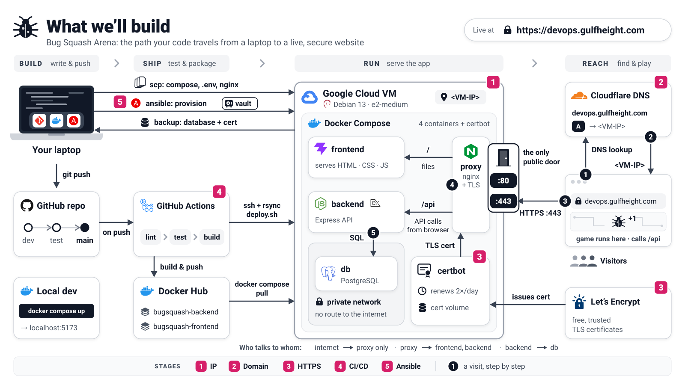

# The deployment journey

[README](../README.md) · [Containers and Docker (theory)](../docs/containers-and-docker.md)

Bug Squash Arena runs on your laptop. These five stages take it to a real website,
one small step at a time. Each stage starts from where the previous one ended, so do them in order.

| Stage | Goal | You will | By the end |
|:-:|---|---|---|
| [1](stage-1-ip-http.md) | **The app on the internet** | rent a VM, install Docker, copy 3 files, start the containers | `http://<VM-IP>` |
| [2](stage-2-domain-http.md) | **A real name** | point a Cloudflare DNS record at the VM | `http://devops.gulfheight.com` |
| [3](stage-3-https.md) | **The padlock** | get a free Let's Encrypt certificate with the certbot container | `https://devops.gulfheight.com` |
| [4](stage-4-automated-deploys.md) | **Push to deploy** | let GitHub Actions build, push and deploy on every merge to `main` | `git push` = live |
| [5](stage-5-ansible.md) | **The VM as code** *(optional)* | describe the whole server in Ansible and rebuild it with one command | a disposable VM |

New to containers? Read [Containers and Docker](../docs/containers-and-docker.md) first: about ten
minutes, mostly pictures.
