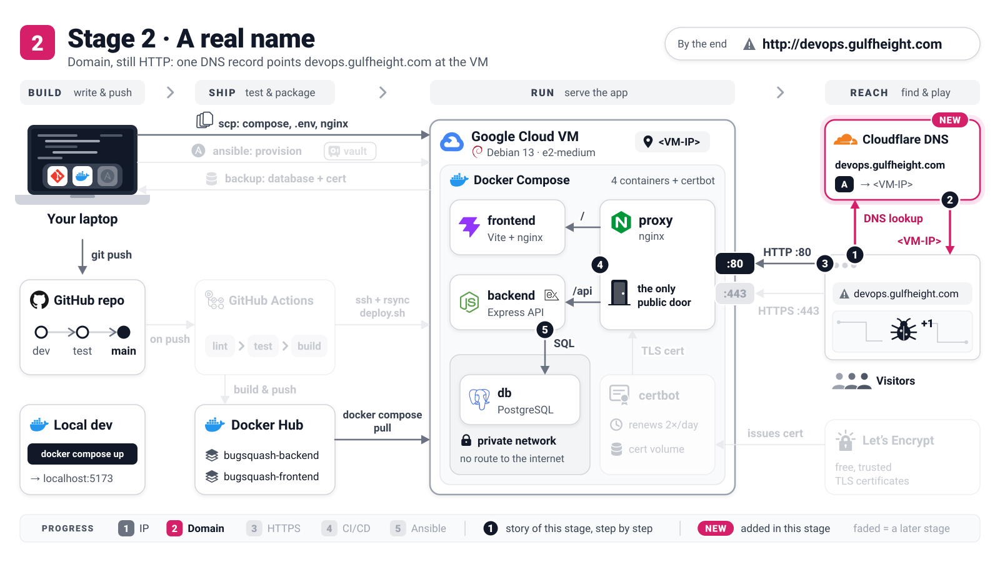

# Stage 2: A name for the site (still HTTP)

[README](../README.md) · [Stage 1](stage-1-ip-http.md) · **Stage 2** · [Stage 3](stage-3-https.md) · [Stage 4](stage-4-automated-deploys.md) · [Stage 5](stage-5-ansible.md)



Your game is online, but `http://34.118.95.243` is not something you put on a poster. In this stage
you add one DNS record so that `devops.gulfheight.com` leads to the VM, and you tell the proxy its
new name. It stays plain HTTP for now: the name has to work before Stage 3 can get a certificate for it.

**By the end:** `http://devops.gulfheight.com` shows the game (and `http://<VM-IP>` still works).

Same conventions as in [Stage 1](stage-1-ip-http.md): `laptop$` or `vm$` shows where a command runs,
`<VM-IP>` is your VM's static external IP and `<you>` your user name on the VM.

> **Concept: DNS.** DNS is the internet's phone book: a browser looks up a name and gets the number
> (IP address) to dial. An *A record* is one line in that book, name -> IPv4 address, and its *TTL*
> says how many seconds other computers may remember the answer.

## 1. Create the A record

Why: Cloudflare manages the phone book for `gulfheight.com`, so the new line is added there.

In the [Cloudflare dashboard](https://dash.cloudflare.com): zone **gulfheight.com -> DNS ->
Records -> Add record**:

| Field | Value |
|-------|-------|
| Type | `A` |
| Name | `devops` (Cloudflare appends `.gulfheight.com`) |
| IPv4 address | `<VM-IP>`, the **static** external IP from Stage 1 |
| Proxy status | **DNS only** (grey cloud) |
| TTL | Auto |

**Save.** Do not add an `AAAA` (IPv6) record: the VM has no IPv6 address, and Let's Encrypt would try
it first in Stage 3.

You should see: the record in the list with a **grey** cloud and the label *DNS only*. Grey means
Cloudflare only answers the lookup; the browser then talks to your VM directly, so what you test is
your own server. (The orange cloud is an option once HTTPS works, see Stage 3.)

## 2. Check the record from your laptop

Why: DNS answers are cached around the world; ask two big public resolvers what they see now.

```console
laptop$ dig +short devops.gulfheight.com @1.1.1.1
laptop$ dig +short devops.gulfheight.com @8.8.8.8
```

You should see your VM's IP from both, for example:

```text
34.118.95.243
34.118.95.243
```

No `dig` on your computer? `nslookup devops.gulfheight.com 1.1.1.1` works on every system.

> [!WARNING]
> A private address such as `10.x.x.x`, `172.16.x.x`-`172.31.x.x` or `192.168.x.x` means the record
> is wrong: nobody on the internet can reach a private address. Use the **External IP** from the
> VM list, not an internal address you saw on the VM. Fix the record, wait a minute, `dig` again.

## 3. Tell the proxy its name

Why: the proxy writes the name into its config, and in Stage 3 it uses the same name to find the
certificate.

Edit `.env.prod` **on your laptop** (it is the master copy) and set `DOMAIN`; keep
`COOKIE_SECURE=false`, because the site is still HTTP:

```console
laptop$ grep -E '^(DOMAIN|COOKIE_SECURE)=' .env.prod
```

You should see:

```text
DOMAIN=devops.gulfheight.com
COOKIE_SECURE=false
```

## 4. Copy the settings and apply them

Why: the VM only knows about the change once it has the new file and Compose has compared it with
what is running.

```console
laptop$ scp .env.prod <you>@<VM-IP>:/opt/devops-workshop/
vm$ cd /opt/devops-workshop
vm$ docker compose -f docker-compose.prod.yml --env-file .env.prod up -d
```

You should see that only the proxy is replaced:

```text
 Container bugsquash-db-1 Running
 Container bugsquash-backend-1 Running
 Container bugsquash-frontend-1 Running
 Container bugsquash-proxy-1 Recreate
 Container bugsquash-proxy-1 Recreated
 ...
 Container bugsquash-proxy-1 Started
```

> **Concept: desired state.** `up -d` does not mean "restart everything". Compose compares what is
> running with what the Compose file and `.env.prod` describe, and changes only the difference, like
> a thermostat that heats only until the room reaches the set temperature. Only the proxy uses
> `DOMAIN`, so only the proxy was recreated; the database never noticed.

## 5. Open the site by its name

Why: check both sides, the proxy's own log and what a visitor gets.

```console
vm$ docker compose -f docker-compose.prod.yml --env-file .env.prod logs proxy | grep select-site-config
laptop$ curl http://devops.gulfheight.com/api/health
```

You should see:

```text
proxy-1  | select-site-config: no certificate for devops.gulfheight.com yet - using the HTTP-only site config (app + ACME challenges on port 80)
{"status":"ok","version":"afbdec7"}
```

Open **`http://devops.gulfheight.com`** in your browser: the same game with the same players, because
it is the same database. `http://<VM-IP>` keeps working as well.

## Checkpoint

- `devops.gulfheight.com` resolves to the VM, at Cloudflare's and at Google's resolvers.
- `http://devops.gulfheight.com` serves the game, and the proxy knows its `DOMAIN`.
- Port 80 also answers on `/.well-known/acme-challenge/`, the door Let's Encrypt knocks on next.

Next: the browser still says *Not secure*. [Stage 3](stage-3-https.md) adds HTTPS.

<details>
<summary>Going deeper: how a DNS lookup travels</summary>

```text
browser: "IP of devops.gulfheight.com?"
   |
   v
recursive resolver (your ISP, 1.1.1.1, 8.8.8.8 ...)   answers from its cache if it can
   |  cache miss: ask the authority
   v
.com servers: "gulfheight.com is served by xxx.ns.cloudflare.com"
   |
   v
Cloudflare (authoritative): "devops.gulfheight.com  A  34.118.95.243  (TTL 300)"
```

- `dig devops.gulfheight.com @1.1.1.1 +noall +answer` also prints the remaining TTL in seconds.
- `dig +short NS gulfheight.com` must list `*.ns.cloudflare.com`, or Cloudflare is not in charge.
- Resolvers also cache "this name does not exist" (*negative caching*): a lookup made before you
  created the record can stay wrong for a few minutes.

</details>

## Troubleshooting

| Symptom | Fix |
|---------|-----|
| `dig` prints nothing | Typo in the *Name* field (it must be `devops`), or a resolver cached "does not exist": wait five minutes and ask `@1.1.1.1` again. |
| `dig` prints `104.x.x.x` or `172.67.x.x` | The record is proxied (orange cloud). Switch it to **DNS only** for now. |
| `dig` prints a `10.x`, `172.16-31.x` or `192.168.x` address | A private IP is in the record. Replace it with the VM's **External IP** from the VM list. |
| `curl http://devops.gulfheight.com` times out, but `http://<VM-IP>` works | The name points somewhere else: compare the `dig` output with the VM's External IP. |
| The browser jumps to `https://devops.gulfheight.com` and shows an error | It remembers HSTS from an earlier Stage 3 (for example on a rebuilt VM). Use a private window, or clear the name at `chrome://net-internals/#hsts`. |
