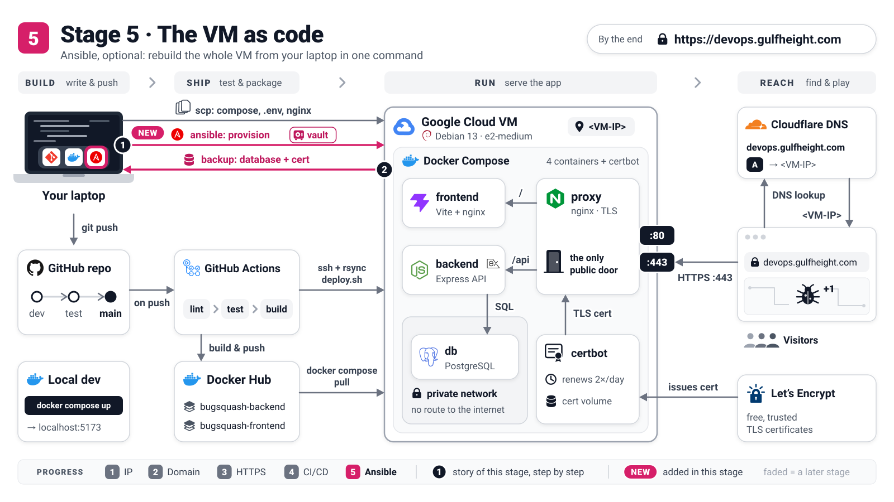

# Stage 5 (optional): The VM as code

[README](../README.md) · [Stage 1](stage-1-ip-http.md) · [Stage 2](stage-2-domain-http.md) · [Stage 3](stage-3-https.md) · [Stage 4](stage-4-automated-deploys.md) · **Stage 5** · [Google Cloud reference](../docs/gcp-vm-reference.md)



Your server works, but the recipe for it lives in your memory and in a long scroll of terminal
history. If the VM died tonight, you would retype Stages 1 to 4 under pressure. In this stage Ansible
writes those steps down as code, so deleting the VM stops being scary.

**By the end:** you delete the VM, create a new one with the same IP, run
`./ansible/provision.sh --new-vm`, and `https://devops.gulfheight.com` is back with its players,
scores and certificate. You type no `vm$` command at all.

Same conventions as in [Stage 1](stage-1-ip-http.md), but every command here is `laptop$`,
run from the repository root. Ansible logs in over SSH as `<you>` and uses `sudo` on the VM for you.

> [!NOTE]
> **How far this is tested.** `docker.yml` (Docker and the `deploy` user) has run for real on the
> course VM, and its second run reported `changed=0`. The rest (`app.yml`, `backup.yml` and the rebuild
> in steps 6 to 8) passes `ansible-lint` (production profile) and syntax checks and has been reviewed
> line by line, but it has not run end to end yet. Rehearse it once on a throwaway VM (*Going deeper*
> below) before you rely on it in class.

> **Concept: a recipe you can re-cook.** A shell script is a list of moves: "add salt". A playbook
> describes the finished dish: "salted". Ansible tastes first and acts only on what is missing, so you
> can run it as often as you like. The proof is the last line of a second run: `changed=0`.

## 1. Install Ansible on your laptop

Why: Ansible runs only on your laptop. The VM needs nothing but SSH and Python, and Debian has both.

```console
laptop$ pipx install ansible-core ansible-lint
laptop$ ansible --version
```

You should see `ansible [core 2.21.5]` or newer (CI uses that version). `ansible-lint` is the
spell-checker the CI runs on this folder. `command not found`? Run `pipx ensurepath` and open a new
terminal. No pipx yet: `sudo apt install pipx` (Linux) or `brew install pipx` (macOS).

## 2. Lock the secrets in a vault (once)

Why: Ansible writes `.env.prod` for you, so it needs the secrets, and those must never sit in Git as
plain text.

```console
laptop$ cd ansible
laptop$ ./bootstrap-secrets.sh --from-env ../.env.prod
laptop$ cd ..
```

`--from-env` adopts the secrets of your running server: it copies `POSTGRES_PASSWORD` and `JWT_SECRET`
from the `.env.prod` you wrote in Stage 1. PostgreSQL stores the password inside the database volume
the first time it starts and ignores the variable after that. A freshly generated password would
therefore lock the backend out of its own database. Keeping `JWT_SECRET` also keeps everyone logged
in. Leave `--from-env` out only for a brand-new site with no server yet.

You should see:

```text
==> 1/4 Application secrets
  [ok] POSTGRES_PASSWORD and JWT_SECRET imported from ../.env.prod
  [ok] DOMAIN / DOCKER_HUB_USERNAME / POSTGRES_DB / POSTGRES_USER match group_vars/all.yml
...
==> 4/4 Encrypting the secrets
  [ok] Wrote .../ansible/secrets/vault.yml ($ANSIBLE_VAULT;1.1;AES256)
```

Now copy the password from `ansible/.vault_pass` into your password manager. Without it, the vault and
every backup are lost for good. `ansible/secrets/vault.yml` is encrypted and may be committed (private
repository only). `.vault_pass` is git-ignored.

> **Concept: a locked safe.** `secrets/vault.yml` is a safe. It can sit in Git, on a USB stick,
> anywhere, because without the key it is noise. `.vault_pass` is the key, and the key never goes
> into Git. Ansible opens the safe in memory, only for the length of a run.

## 3. Point Ansible at the VM and take a first backup

Why: before a robot touches a server with real players on it, you want their data on your laptop.
`backup.yml` only reads from the VM.

```console
laptop$ cp ansible/inventory.example.ini ansible/inventory.ini
laptop$ nano ansible/inventory.ini        # ansible_host=<VM-IP> ansible_user=<you>
laptop$ ./ansible/provision.sh backup.yml
```

You should see the backup's summary and its encrypted files:

```text
TASK [backup : Summary] ********************************************************
ok: [devops] =>
  msg:
  - 'Backup 20261013T180512Z of devops: 12 users, certificate for devops.gulfheight.com'
  - 'Folder: .../ansible/backups/devops.gulfheight.com'
  - db-20261013T180512Z.dump.vault
  - db-latest.dump.vault
  - letsencrypt-20261013T180512Z.tar.gz.vault
  - letsencrypt-latest.tar.gz.vault

Done. The encrypted backups are listed above.
```

A new server restores the `*-latest` files. An empty database (0 users) never becomes
`db-latest`, because there would be nothing to restore. The folder is git-ignored, so keep a copy
somewhere safe, such as a cloud drive.

## 4. Adopt the hand-made server

Why: the first run takes over the server you built in Stages 1 to 3 (or 4). It keeps the same
secrets and the same volumes, and changes only what differs from the recipe.

```console
laptop$ ./ansible/provision.sh
laptop$ ./ansible/provision.sh
```

The first run takes a few minutes. It makes `deploy` the owner of `/opt/devops-workshop` (Stage 4,
step 3, done for you). It replaces the hand-copied bundle with the one from Git and renders
`.env.prod` from the vault, with `COOKIE_SECURE=true` because it finds your certificate. The
`letsencrypt` and `pgdata` volumes stay untouched. Then it runs `deploy.sh` once and checks the site
through the proxy. The second run is the proof. At its end you should see:

```text
TASK [app : Show the answer] ***************************************************
ok: [devops] =>
  msg:
  - '{"status":"ok","version":"afbdec7"}'
  - https://devops.gulfheight.com/api/health -> HTTP 200

PLAY RECAP *********************************************************************
devops : ok=...  changed=0  unreachable=0  failed=0  skipped=...  rescued=0  ignored=0

Done. Run it again any time: the second run should report changed=0.
```

From now on `.env.prod` and `/opt/devops-workshop` belong to Ansible. To change something, edit Git,
`ansible/group_vars/all.yml` or the vault, then run `provision.sh` again: hand edits on the VM are
overwritten.

## 5. Let Ansible keep GitHub and DNS in sync (optional)

Why: a rebuilt VM has a new SSH host key, so the Stage 4 deploy job refuses to connect until
`DEPLOY_KNOWN_HOSTS` is updated. Ansible can update it, and the A record too.

```console
laptop$ gh auth login
laptop$ nano ansible/group_vars/all.yml      # github_ci_sync: true
laptop$ cd ansible && ansible-vault edit secrets/vault.yml --vault-password-file .vault_pass && cd ..
laptop$ ./ansible/provision.sh app.yml --tags github_ci,dns
```

In the vault, set `vault_cloudflare_api_token: "<token>"`. Create the token in Cloudflare under
*My Profile -> API Tokens* with the template *Edit zone DNS* for zone `gulfheight.com`. The two parts
are independent, so you can skip either one.

You should see `Set the repository secrets` changed for `DEPLOY_HOST`, `DEPLOY_USER`,
`DEPLOY_SSH_KEY` and `DEPLOY_KNOWN_HOSTS`, plus `Turn the deploy job on`. That switches on Stage 4's
automatic deploys if they were off. A second run skips the GitHub tasks (`changed=0`). The DNS role
changes nothing while the record already points at the VM: the token only matters on the day the IP
changes.

GitHub now holds the vault's CI key instead of Stage 4's `~/.ssh/bugsquash_ci`. If you skip this
step, set `DEPLOY_SSH_KEY` (`vault_ci_deploy_private_key` in `ansible-vault view`) and
`DEPLOY_KNOWN_HOSTS` by hand after every rebuild.

> [!WARNING]
> Steps 6 to 8 delete the real VM. Do them once on a throwaway VM first: see *Going deeper: rehearse
> the rebuild on a throwaway VM* below. Never rehearse in a container on your laptop.

## 6. Back up right before you delete

Why: the backup is the only thing that survives the VM. Whatever happens after it is lost.

```console
laptop$ ./ansible/provision.sh backup.yml
```

You should see the summary from step 3, with a new timestamp and today's number of users.

## 7. Delete the VM and create a new one

Why: this is the drill. Use the same name, zone and static IP (`devops-ip`). Pass your SSH key when
you create the VM, because Stage 1 stored it in the old VM's metadata, which is deleted with it.

```console
laptop$ gcloud compute instances delete devops --zone=europe-central2-a
laptop$ gcloud compute instances create devops --zone=europe-central2-a --machine-type=e2-medium \
          --image-family=debian-13 --image-project=debian-cloud \
          --boot-disk-size=20GB --boot-disk-type=pd-balanced --tags=http-server,https-server \
          --address=devops-ip --no-service-account --no-scopes \
          --metadata=ssh-keys="<you>:$(cat ~/.ssh/id_ed25519.pub)"
```

These are Stage 1's settings. The course VM today has the default 10 GB disk and the default service
account; the new one gets 20 GB and no Google credentials at all, because the app calls no Google API
([GCP reference, section 4](../docs/gcp-vm-reference.md#4-ssh-access)). To do this in the console
instead, follow Stage 1, step 1, and also pick *External IPv4 address: devops-ip* and add your key
under *Security -> Add manually generated SSH keys*.

You should see `Deleted [.../instances/devops]`, then a table with `devops`, `<VM-IP>` as
`EXTERNAL_IP` and `RUNNING`. The site is down now, and the old disk is gone.

> **Concept: pets vs cattle.** The hand-made VM was a pet: it has a name, you nurse it when it is ill,
> and losing it hurts. With a recipe, a vault and a backup it becomes cattle: when one is ill, you
> replace it with an identical one. Production servers should be cattle.

## 8. One command

Why: `--new-vm` forgets the old VM's SSH host key (the new VM has a fresh one). Then `site.yml`
builds everything: Docker, the `deploy` user, the bundle, `.env.prod`, both restores, HTTPS and the
renewal timer.

```console
laptop$ ./ansible/provision.sh --new-vm
laptop$ ./ansible/provision.sh
```

You should see these lines during the first run, which takes about 5 to 10 minutes:

```text
==> New VM: forgetting old SSH host keys
  [ok] forgot the old host key of 34.118.95.243 (backup: ~/.ssh/known_hosts.old)
...
  msg: .env.prod updated - DOMAIN=devops.gulfheight.com, IMAGE_TAG=latest, COOKIE_SECURE=true (certificate will be restored from backup)
...
  - 'Reason: the bundle changed; .env.prod changed; a certificate was restored; not running: backend, db, frontend, proxy'
...
  msg: Database restored from .../ansible/backups/devops.gulfheight.com/db-latest.dump.vault - 12 users.
```

The second run should end with `changed=0`. Log in on `https://devops.gulfheight.com` with an old
account: your scores are there, and the padlock is green. Here is what came back, and from where:

| What | After the rebuild | Comes from |
|------|-------------------|------------|
| Players, password hashes, scores | restored, only into an empty `users` table | `backups/<domain>/db-latest.dump.vault` |
| Certificate and Let's Encrypt account | restored before the proxy starts (requested anew only without a backup) | `backups/<domain>/letsencrypt-latest.tar.gz.vault` |
| `POSTGRES_PASSWORD`, `JWT_SECRET` (logins stay valid), CI key | unchanged | `secrets/vault.yml` |
| Docker, `deploy` user, bundle, `.env.prod`, renewal timer | rebuilt | Git and `group_vars/all.yml` |
| App images | pulled again | Docker Hub (`image_tag`) |
| The VM's SSH host key | **new** | `--new-vm` locally; step 5 updates GitHub |
| Players and scores newer than the last backup | **lost** | run step 6 right before you delete |

## Checkpoint

- `./ansible/provision.sh` turns a fresh VM into the working HTTPS site, and a second run reports `changed=0`.
- `backup.yml` leaves encrypted database and certificate backups in `ansible/backups/<domain>/`, and
  the vault password is in your password manager.
- Delete, create, `--new-vm`: the players and the padlock come back, and you typed no `vm$` command.

This is the last stage. Back to the [README](../README.md), or revisit
[Stage 4](stage-4-automated-deploys.md), whose CI deploys this stage keeps working.

<details>
<summary>Going deeper: rehearse the rebuild on a throwaway VM</summary>

Practise on a second, cheap VM in the cloud (`e2-small`, a few cents per hour) that has its own IP
and its own name, so the real site, its DNS record and GitHub's settings are never touched. **Never on
a laptop container:** a "fake VM" container needs `--privileged` and systemd, it crashed the
instructor's desktop twice, and it lacks what matters here (Google's firewall, metadata server and
guest agent).

```console
laptop$ gcloud compute addresses create rehearsal-ip --region=europe-central2
laptop$ gcloud compute addresses describe rehearsal-ip --region=europe-central2 --format='value(address)'
laptop$ gcloud compute instances create rehearsal --zone=europe-central2-a --machine-type=e2-small \
          --image-family=debian-13 --image-project=debian-cloud --boot-disk-size=20GB \
          --tags=http-server,https-server --address=rehearsal-ip --no-service-account --no-scopes \
          --metadata=ssh-keys="<you>:$(cat ~/.ssh/id_ed25519.pub)"
```

Point an A record `rehearsal.gulfheight.com` at the printed `<TEST-IP>` (DNS only, grey cloud). With a
Cloudflare token in the vault, Ansible creates it for you. Every run of the drill below takes three
overrides:

- a different `domain`, which gives the rehearsal its own certificate and its own backup folder;
- the Let's Encrypt staging CA, which has no tight rate limits;
- no GitHub sync, so CI keeps deploying to the real VM.

```console
laptop$ ./ansible/provision.sh <you>@<TEST-IP> -e domain=rehearsal.gulfheight.com -e tls_staging=true -e github_ci_sync=false
laptop$ ./ansible/provision.sh <you>@<TEST-IP> -e domain=rehearsal.gulfheight.com -e tls_staging=true -e github_ci_sync=false
laptop$ curl -sk -c /tmp/r.jar -H 'Content-Type: application/json' -d '{"username":"rehearsal1","password":"rehearsal-pass"}' https://rehearsal.gulfheight.com/api/auth/signup
laptop$ curl -sk -b /tmp/r.jar -H 'Content-Type: application/json' -d '{"score":42}' https://rehearsal.gulfheight.com/api/scores
laptop$ ./ansible/provision.sh <you>@<TEST-IP> backup.yml -e domain=rehearsal.gulfheight.com
laptop$ gcloud compute instances delete rehearsal --zone=europe-central2-a
laptop$ gcloud compute instances create rehearsal ...                  # the same create command as above
laptop$ ./ansible/provision.sh --new-vm <you>@<TEST-IP> -e domain=rehearsal.gulfheight.com -e tls_staging=true -e github_ci_sync=false
laptop$ ./ansible/provision.sh <you>@<TEST-IP> -e domain=rehearsal.gulfheight.com -e tls_staging=true -e github_ci_sync=false
laptop$ curl -sk https://rehearsal.gulfheight.com/api/scores/leaderboard
```

The rehearsal passes when the second run in each pair reports `changed=0`, and the last command
prints `{"leaderboard":[{"rank":1,"username":"rehearsal1","best":42}]}` after the rebuild. Then clean
up, and delete the `rehearsal` record in Cloudflare:

```console
laptop$ gcloud compute instances delete rehearsal --zone=europe-central2-a
laptop$ gcloud compute addresses delete rehearsal-ip --region=europe-central2
laptop$ rm -r ansible/backups/rehearsal.gulfheight.com && ssh-keygen -R <TEST-IP>
```

</details>

<details>
<summary>Going deeper: provision.sh, playbooks, tags and settings</summary>

`./ansible/provision.sh [--new-vm] [user@host[:port]] [playbook.yml] [ansible-playbook options...]`
runs from anywhere, always with `ansible/ansible.cfg`, and finds `.vault_pass` by itself.

| Command | What it does |
|---------|--------------|
| `./ansible/provision.sh` | `site.yml` = `docker.yml` (the machine) + `app.yml` (the app), hosts from `inventory.ini` |
| `./ansible/provision.sh <you>@<IP> docker.yml` | one playbook, no inventory file needed |
| `./ansible/provision.sh docker.yml --check --diff` | dry run: show what would change (`docker.yml` only) |
| `./ansible/provision.sh app.yml --tags tls` | one part: `dns`, `app`, `tls`, `github_ci` (in `docker.yml`: `common`, `docker`, `deploy_user`) |
| `./ansible/provision.sh -e image_tag=sha-1a2b3c4` | any setting below, for one run |

Shared settings live in `group_vars/all.yml`. Each role's own settings live in
`roles/<role>/defaults/main.yml`.

| Setting | Default | Meaning |
|---------|---------|---------|
| `domain` | `devops.gulfheight.com` | `DOMAIN`, the certificate's name, the backup folder |
| `image_tag` | `latest` | `IMAGE_TAG` in `.env.prod` |
| `app_dir`, `deploy_user` | `/opt/devops-workshop`, `deploy` | the bundle and its owner |
| `letsencrypt_email` | empty | Let's Encrypt account e-mail (optional) |
| `cloudflare_zone`, `cloudflare_proxied` | `gulfheight.com`, `false` | used only with a token in the vault |
| `github_repo`, `github_ci_sync` | this repository, `false` | step 5 |
| `app_force_deploy` | `false` | run `deploy.sh` even if nothing changed (pull a newer `latest`) |
| `app_restore_backups` | `true` | restore the `*-latest` backups onto a server without data |
| `tls_staging`, `tls_issue_certificate` | `false`, `true` | use the staging CA; ask Let's Encrypt at all |
| `common_unattended_reboot` | `false` | reboot at 04:00 when a security update needs it |

The second run stays at `changed=0` because `deploy.sh` runs only when the bundle or `.env.prod`
changed, a certificate was restored, a container is down, or `app_force_deploy=true`. If DNS does not
point at the VM yet, the run still succeeds. It prints *WARNING - no certificate yet*, the site stays
on HTTP, and the next run or the renewal timer finishes HTTPS.

</details>

## Troubleshooting

| Symptom | Fix |
|---------|-----|
| `REMOTE HOST IDENTIFICATION HAS CHANGED` or `UNREACHABLE` right after recreating the VM | The new VM has a new host key: add `--new-vm`. |
| `Permission denied (publickey)` on the new VM | Your key lived in the old VM's metadata. Create the VM with `--metadata=ssh-keys=...` (step 7), or add the key once under *Compute Engine -> Metadata -> SSH keys* for every VM in the project. |
| `Attempting to decrypt but no vault secrets found` | `ansible/.vault_pass` is missing (a new laptop or a fresh clone). Restore it from your password manager and `chmod 600` it. |
| Stops at `Fail early if the vault would lock the backend out of its database` | Step 2 ran without `--from-env`. Nothing was changed: run `./ansible/bootstrap-secrets.sh --force --from-env .env.prod`, then run again. |
| CI deploy after a rebuild: `Host key verification failed` or `Permission denied (publickey)` | GitHub still has the old VM's host key or Stage 4's key. Do step 5, or update `DEPLOY_KNOWN_HOSTS` and `DEPLOY_SSH_KEY` by hand. |
